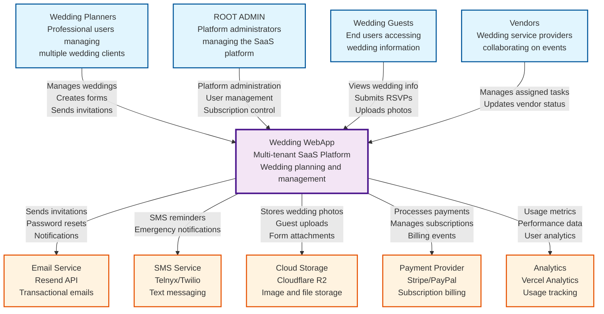

# System Context - Wedding WebApp

## Overview

The Wedding WebApp is a multi-tenant SaaS platform designed for professional wedding planners to manage their clients' weddings, guest lists, RSVPs, and communications. The system operates as a secure, scalable platform serving multiple wedding planning businesses.

## System Context Diagram

## System Purpose and Scope

### Primary Purpose
The Wedding WebApp serves as a comprehensive platform for professional wedding planners to:
- Manage multiple client weddings simultaneously
- Coordinate with guests, vendors, and other stakeholders
- Streamline communication and RSVP processes
- Maintain privacy and security for sensitive wedding information
- Scale their business with subscription-based features

### System Boundaries

#### What's Inside the System
- **User Authentication & Authorization** - Multi-role access control
- **Wedding Management** - Complete wedding lifecycle management
- **Guest Management** - Guest lists, invitations, and RSVPs
- **Form Builder** - Custom forms for feedback and data collection
- **Communication Hub** - Email and SMS coordination
- **Privacy Controls** - Guest verification and access management
- **Subscription Management** - SaaS billing and feature gating
- **Analytics Dashboard** - Business insights and reporting

#### What's Outside the System
- **Email Delivery Infrastructure** - Handled by Resend
- **SMS Gateway Services** - Managed by Telnyx/Twilio
- **File Storage Infrastructure** - Provided by Cloudflare R2
- **Payment Processing** - Processed by Stripe/PayPal
- **Domain Management** - External DNS and domain services

## Key System Characteristics

### Multi-Tenancy
- **Tenant Isolation**: Each wedding planning business operates independently
- **Data Segregation**: Strict separation of client data between tenants
- **Resource Sharing**: Efficient utilization of system resources across tenants
- **Customization**: Tenant-specific branding and configuration options

### Security & Privacy
- **Privacy by Default**: All weddings start as private requiring guest verification
- **Role-Based Access Control**: Fine-grained permissions for different user types
- **Data Encryption**: End-to-end encryption for sensitive information
- **Audit Logging**: Comprehensive tracking of system access and changes

### Scalability
- **Horizontal Scaling**: Designed to scale across multiple instances
- **Database Optimization**: Efficient querying and indexing strategies
- **Caching Layer**: Redis-based caching for improved performance
- **CDN Integration**: Global content delivery for media assets

## User Personas

### 1. ROOT ADMIN (Platform Owner)
**Role**: Platform administrator and system owner
**Responsibilities**:
- Platform-wide configuration and settings
- User management and subscription oversight
- System monitoring and maintenance
- Business analytics and reporting

**Key Interactions**:
- User invitation and role assignment
- Subscription plan management
- System configuration updates
- Platform analytics review

### 2. Wedding Planner (Primary User)
**Role**: Professional wedding planning business owner
**Responsibilities**:
- Managing multiple client weddings
- Coordinating with guests and vendors
- Creating and managing custom forms
- Tracking RSVPs and communications

**Key Interactions**:
- Wedding creation and management
- Guest list import and management
- Form building and distribution
- Communication with guests via email/SMS

### 3. Wedding Guests (End Users)
**Role**: Individuals invited to weddings
**Responsibilities**:
- Accessing wedding information
- Submitting RSVPs and plus-one details
- Uploading photos to wedding galleries
- Completing custom forms

**Key Interactions**:
- Guest verification and authentication
- RSVP submission and updates
- Photo gallery interaction
- Form completion and submission

### 4. Vendors (Collaborators)
**Role**: Wedding service providers (photographers, caterers, etc.)
**Responsibilities**:
- Managing assigned vendor tasks
- Updating service status and deliverables
- Communicating with wedding planners

**Key Interactions**:
- Task management and updates
- Status reporting and communication
- Collaboration with wedding planning team

## External Dependencies

### Critical Dependencies
1. **MongoDB Atlas** - Primary data storage (High criticality)
2. **Resend Email API** - Email communication (High criticality)
3. **Cloudflare R2** - File and image storage (Medium criticality)
4. **Telnyx/Twilio SMS** - Text messaging (Medium criticality)

### Optional Dependencies
1. **Stripe/PayPal** - Payment processing (Medium criticality)
2. **Vercel Analytics** - Usage tracking (Low criticality)
3. **Third-party Integrations** - Calendar syncing, social media (Low criticality)

## Integration Patterns

### API-First Architecture
- **RESTful APIs**: Standard HTTP-based communication
- **OpenAPI Documentation**: Comprehensive API documentation
- **Webhook Support**: Event-driven integration with external systems
- **Rate Limiting**: Protection against abuse and overuse

### Event-Driven Communication
- **Domain Events**: Internal system events for consistency
- **External Notifications**: Webhook delivery to external systems
- **Audit Trail**: Complete event logging for compliance

### Data Synchronization
- **Real-time Updates**: Live updates for guest interactions
- **Batch Processing**: Bulk operations for data imports
- **Conflict Resolution**: Handling concurrent updates gracefully

## Business Context

### Market Position
- **Target Market**: Professional wedding planning businesses
- **Competitive Advantage**: Privacy-focused, multi-tenant architecture
- **Value Proposition**: Streamlined wedding management with advanced security

### Business Model
- **Subscription-based SaaS**: Tiered pricing with feature gating
- **Usage-based Limits**: Scalable pricing based on wedding count and features
- **Enterprise Features**: Advanced analytics and customization options

---

**Next**: [Container Architecture](./02-container-architecture.md)
**Related**: [Security Architecture](./06-security-architecture.md)