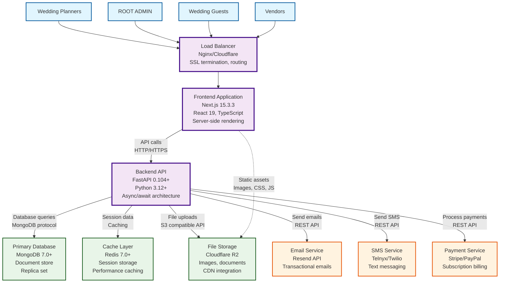

# Container Architecture - Wedding WebApp

## Overview

The Wedding WebApp follows a modular monolith architecture with clear container boundaries. The system is designed for easy decomposition into microservices as it scales, while maintaining operational simplicity in the current deployment.

## Container Diagram



## Container Responsibilities

### 1. Frontend Application (Next.js)

**Technology Stack:**
- **Framework**: Next.js 15.3.3 with App Router
- **Runtime**: React 19.1.0 with concurrent features
- **Language**: TypeScript 5.8.3 with strict mode
- **Styling**: Tailwind CSS 3.4.0 with custom design system
- **UI Components**: Headless UI, Heroicons

**Key Responsibilities:**
- **Server-Side Rendering**: Dynamic page generation with SEO optimization
- **Authentication UI**: Login flows for different user roles
- **Dashboard Views**: Role-specific interfaces for planners, admins, vendors
- **Form Management**: Dynamic form builder with drag-and-drop interface
- **Guest Verification**: Privacy-focused guest access controls
- **File Uploads**: Image and document upload handling
- **Real-time Updates**: Live RSVP updates and notifications

**Security Features:**
- **CSP Headers**: Content Security Policy enforcement
- **XSS Protection**: Input sanitization and output encoding
- **CSRF Protection**: Token-based request validation
- **Secure Cookies**: HTTP-only, secure cookie management

### 2. Backend API (FastAPI)

**Technology Stack:**
- **Framework**: FastAPI 0.104+ with automatic OpenAPI generation
- **Runtime**: Python 3.12+ with asyncio support
- **Database ORM**: Motor (async MongoDB driver)
- **Authentication**: JWT with python-jose
- **Validation**: Pydantic 2.0+ for request/response models

**Key Responsibilities:**
- **Authentication & Authorization**: JWT-based auth with role hierarchy
- **Business Logic**: Wedding management, guest handling, RSVP processing
- **API Gateway**: RESTful endpoints with OpenAPI documentation
- **File Processing**: Image optimization and storage management
- **Communication Services**: Email and SMS integration
- **Subscription Management**: Feature gating and billing logic
- **Data Validation**: Input validation and business rule enforcement

**Middleware Stack (in order):**
1. **Error Handler**: Global exception handling and logging
2. **Security Headers**: HSTS, CSP, X-Frame-Options
3. **CSRF Protection**: Token validation for state-changing operations
4. **Audit Logging**: Request/response logging for compliance
5. **Performance Monitoring**: Request timing and resource usage
6. **Rate Limiting**: Configurable limits per endpoint type
7. **CORS**: Cross-origin request handling
8. **Compression**: GZip compression for responses

**API Structure:**
```
/health # Health checks and system status
/admin/* # Admin-only endpoints (authentication required)
/guest/* # Guest management (public with verification)
/rsvp/* # RSVP handling (public)
/forms/* # Form builder and submission
/gallery/* # Photo gallery management
/weddings/* # Wedding information access
/subscription/* # Subscription and billing
```

### 3. Primary Database (MongoDB)

**Technology Stack:**
- **Version**: MongoDB 7.0+ with replica set configuration
- **Driver**: Motor (async Python driver)
- **Schema**: Flexible document schema with validation
- **Indexing**: Optimized indexes for query performance

**Data Organization:**
```
Collections:
 users # User accounts and authentication
 weddings # Wedding information and settings
 guests # Guest lists and contact information
 rsvps # RSVP responses and status
 forms # Custom forms and templates
 form_responses # Form submission data
 subscriptions # Subscription plans and usage
 audit_logs # Security and access logging
 system_config # Platform configuration
```

**Key Features:**
- **Multi-tenancy**: Tenant-aware data isolation
- **Indexing Strategy**: Compound indexes for common queries
- **Data Validation**: Schema validation at database level
- **Replica Set**: High availability with automatic failover
- **Backup Strategy**: Point-in-time recovery capabilities

### 4. Cache Layer (Redis)

**Technology Stack:**
- **Version**: Redis 7.0+ with persistence
- **Driver**: Redis-py with async support
- **Configuration**: Optimized for session storage and caching

**Cache Strategies:**
- **Session Storage**: User authentication sessions
- **API Response Caching**: Frequently accessed data
- **Rate Limiting Counters**: Sliding window rate limiting
- **Background Job Queue**: Async task processing
- **Real-time Features**: WebSocket connection management

**Cache Patterns:**
```
Key Patterns:
 session:{user_id} # User session data
 wedding:{wedding_id} # Wedding information cache
 ratelimit:{ip}:{endpoint} # Rate limiting counters
 form:{form_id} # Form definition cache
 metrics:{date} # Daily metrics aggregation
```

### 5. File Storage (Cloudflare R2)

**Technology Stack:**
- **Service**: Cloudflare R2 (S3-compatible)
- **CDN**: Cloudflare CDN for global distribution
- **Processing**: Image optimization and resizing

**Storage Organization:**
```
Bucket Structure:
 weddings/{wedding_id}/
 gallery/ # Wedding photo gallery
 documents/ # Wedding-related documents
 uploads/ # Guest-uploaded content
 forms/{form_id}/
 attachments/ # Form file attachments
 users/{user_id}/
 profile/ # User profile images
 system/
 templates/ # System templates and assets
```

**Security Features:**
- **Presigned URLs**: Secure, time-limited access to files
- **Access Controls**: Tenant-aware file access permissions
- **Virus Scanning**: Automated malware detection (planned)
- **Content Types**: Restricted file type uploads

## Communication Patterns

### 1. Frontend ↔ Backend Communication

**Protocol**: HTTPS REST API
**Authentication**: Bearer JWT tokens
**Content Type**: JSON with Pydantic validation
**Error Handling**: Standardized error responses

```typescript
// Example API call pattern
const response = await fetch(`${API_BASE_URL}/admin/weddings`, {
 method: 'GET',
 headers: {
 'Authorization': `Bearer ${token}`,
 'Content-Type': 'application/json'
 }
});
```

### 2. Backend ↔ Database Communication

**Protocol**: MongoDB Wire Protocol (async)
**Connection Pooling**: Configurable pool size with health checking
**Transactions**: ACID transactions for complex operations
**Error Handling**: Connection retry with exponential backoff

```python
# Example database operation
async def get_wedding_by_id(wedding_id: str) -> Wedding:
 collection = database.get_collection("weddings")
 wedding_doc = await collection.find_one({"_id": ObjectId(wedding_id)})
 return Wedding.model_validate(wedding_doc)
```

### 3. Backend ↔ Cache Communication

**Protocol**: Redis protocol (RESP)
**Serialization**: JSON for complex objects, strings for simple values
**TTL Strategy**: Time-based expiration with refresh patterns
**Fallback**: Graceful degradation when cache unavailable

```python
# Example cache operation
async def get_cached_wedding(wedding_id: str) -> Optional[Wedding]:
 cached_data = await redis.get(f"wedding:{wedding_id}")
 if cached_data:
 return Wedding.model_validate_json(cached_data)
 return None
```

## Deployment Architecture

### Development Environment
```
Single Machine:
 Next.js (port 3000/3002)
 FastAPI (port 8000/8002)
 MongoDB (port 27017)
 Redis (port 6379)
 File Storage (local/mock)
```

### Production Environment (Current)
```
Container Orchestration:
 Load Balancer (Nginx/Cloudflare)
 Frontend Container (Next.js)
 Backend Container (FastAPI + Gunicorn)
 MongoDB Cluster (3 nodes)
 Redis Cluster (primary + replica)
 CDN (Cloudflare R2 + CDN)
```

### Future Microservices Architecture
```
Service Mesh:
 API Gateway
 User Service (authentication)
 Wedding Service (core domain)
 Communication Service (email/SMS)
 Form Service (form builder)
 File Service (storage management)
 Analytics Service (reporting)
```

## Scalability Considerations

### Horizontal Scaling
- **Stateless Design**: All containers can scale horizontally
- **Database Sharding**: Future sharding strategy for MongoDB
- **Cache Clustering**: Redis cluster for high availability
- **CDN Distribution**: Global file distribution

### Performance Optimization
- **Connection Pooling**: Optimized database connections
- **Query Optimization**: Indexed queries and aggregation pipelines
- **Caching Strategy**: Multi-layer caching approach
- **Compression**: Response compression and image optimization

### Monitoring & Observability
- **Health Checks**: Container health monitoring
- **Metrics Collection**: Performance and business metrics
- **Distributed Tracing**: Request tracing across containers
- **Log Aggregation**: Centralized logging and analysis

---

**Next**: [Component Architecture](./03-component-architecture.md) 
**Previous**: [System Context](./01-system-context.md)