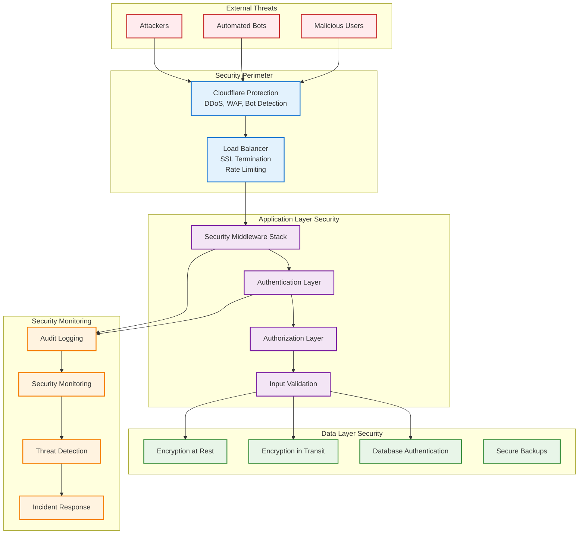
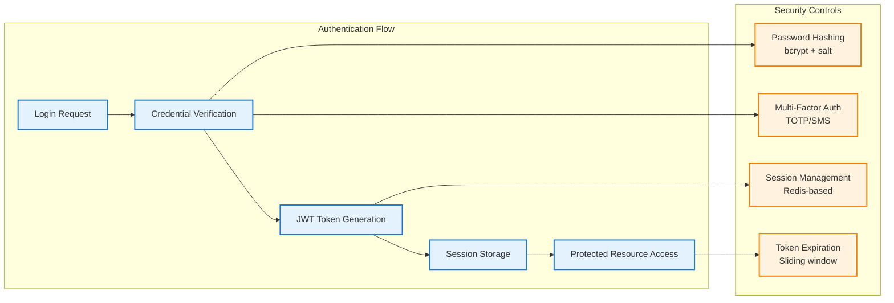

# Security Architecture - Wedding WebApp

## Overview

The Wedding WebApp implements a comprehensive security architecture following defense-in-depth principles. Security is designed into every layer of the application, from authentication and authorization to data protection and privacy controls.

## Security Architecture Diagram



## Security Layers

### 1. Perimeter Security

#### Cloudflare Protection
**DDoS Protection**:
- Automatic DDoS mitigation up to 100+ Gbps
- Layer 3, 4, and 7 attack protection
- Global anycast network for traffic distribution

**Web Application Firewall (WAF)**:
- OWASP Top 10 protection
- Custom security rules for wedding-specific threats
- Real-time threat intelligence integration
- Bot detection and mitigation

**SSL/TLS Configuration**:
```
SSL Configuration:
 TLS 1.3 minimum version
 Perfect Forward Secrecy (PFS)
 HSTS headers with preload
 Certificate transparency monitoring
 Automatic certificate renewal
```

#### Load Balancer Security
**Rate Limiting**:
- IP-based rate limiting: 100 requests/minute
- Authentication endpoint limits: 10 requests/minute
- Sliding window algorithm implementation
- Whitelist for trusted IPs

**SSL Termination**:
- Strong cipher suites only
- OCSP stapling enabled
- Certificate pinning for API clients

### 2. Application Layer Security

#### Security Middleware Stack

```python
# Middleware execution order (outermost to innermost)
MIDDLEWARE = [
 "app.middleware.error_handler.ErrorHandlerMiddleware", # 1. Global exception handling
 "app.middleware.security_headers.SecurityHeadersMiddleware", # 2. Security headers
 "app.middleware.csrf_protection.CSRFProtectionMiddleware", # 3. CSRF protection
 "app.middleware.audit_logging.AuditLoggingMiddleware", # 4. Audit logging
 "app.middleware.performance_monitoring.PerformanceMonitoringMiddleware", # 5. Performance
 "app.middleware.rate_limiting.RateLimitMiddleware", # 6. Rate limiting
 "fastapi.middleware.cors.CORSMiddleware", # 7. CORS
 "fastapi.middleware.gzip.GZipMiddleware", # 8. Compression
]
```

**Security Headers Middleware**:
```python
SECURITY_HEADERS = {
 "Strict-Transport-Security": "max-age=31536000; includeSubDomains; preload",
 "Content-Security-Policy": "default-src 'self'; script-src 'self' 'unsafe-inline'",
 "X-Frame-Options": "DENY",
 "X-Content-Type-Options": "nosniff",
 "Referrer-Policy": "strict-origin-when-cross-origin",
 "Permissions-Policy": "geolocation=(), microphone=(), camera=()"
}
```

**CSRF Protection**:
- Double-submit cookie pattern
- SameSite cookie attributes
- Origin and Referer header validation
- State-changing operations protection

#### Authentication Architecture



**JWT Token Security**:
```python
JWT_SETTINGS = {
 "algorithm": "RS256", # Asymmetric encryption
 "access_token_expire": 15, # 15 minutes
 "refresh_token_expire": 7, # 7 days
 "issuer": "wedding-webapp",
 "audience": "wedding-users",
 "key_rotation": "monthly" # Regular key rotation
}
```

**Password Security**:
- bcrypt hashing with cost factor 12
- Minimum 12 characters with complexity requirements
- Password history prevention (last 5 passwords)
- Account lockout after 5 failed attempts
- Progressive delays for repeated failures

#### Authorization Architecture

**Role-Based Access Control (RBAC)**:
```python
ROLES_HIERARCHY = {
 "ROOT_ADMIN": {
 "level": 100,
 "permissions": ["*"], # All permissions
 "description": "Platform administrator"
 },
 "wedding_planner": {
 "level": 50,
 "permissions": [
 "wedding:read", "wedding:write", "wedding:delete",
 "guest:read", "guest:write", "guest:delete",
 "form:read", "form:write", "form:delete",
 "rsvp:read", "rsvp:write"
 ],
 "description": "Wedding planning professional"
 },
 "vendor": {
 "level": 30,
 "permissions": [
 "wedding:read", "guest:read", "task:read", "task:write"
 ],
 "description": "Wedding service provider"
 },
 "guest": {
 "level": 10,
 "permissions": [
 "wedding:read_limited", "rsvp:write", "gallery:read"
 ],
 "description": "Wedding guest"
 }
}
```

**Permission Enforcement**:
```python
@require_permission("wedding:write")
async def update_wedding(
 wedding_id: str,
 wedding_data: WeddingUpdate,
 current_user: AuthUser = Depends(get_current_user)
) -> Wedding:
 # Verify user owns or has access to this wedding
 await check_wedding_access(current_user, wedding_id)
 return await wedding_service.update(wedding_id, wedding_data)
```

**Multi-Tenant Security**:
- Tenant-aware data queries
- Row-level security enforcement
- Cross-tenant access prevention
- Audit logging for data access

### 3. Data Protection

#### Encryption Strategy

**Encryption at Rest**:
```python
ENCRYPTION_SETTINGS = {
 "database": {
 "method": "AES-256-GCM",
 "key_management": "AWS KMS",
 "field_level": ["email", "phone", "address"]
 },
 "file_storage": {
 "method": "AES-256-CBC",
 "key_rotation": "quarterly",
 "access_control": "signed_urls"
 },
 "backups": {
 "method": "AES-256-GCM",
 "verification": "integrity_checks",
 "retention": "7_years"
 }
}
```

**Encryption in Transit**:
- TLS 1.3 for all external communications
- mTLS for internal service communication
- Certificate pinning for critical connections
- Perfect Forward Secrecy (PFS) implementation

#### Data Classification

**Data Sensitivity Levels**:
```python
DATA_CLASSIFICATION = {
 "PUBLIC": {
 "examples": ["wedding date", "venue name"],
 "protection": "integrity_only",
 "retention": "indefinite"
 },
 "INTERNAL": {
 "examples": ["guest count", "budget ranges"],
 "protection": "access_control",
 "retention": "5_years"
 },
 "CONFIDENTIAL": {
 "examples": ["guest contact info", "payment details"],
 "protection": "encryption + access_control",
 "retention": "3_years"
 },
 "RESTRICTED": {
 "examples": ["authentication credentials", "personal data"],
 "protection": "strong_encryption + strict_access",
 "retention": "as_required_by_law"
 }
}
```

#### Privacy Controls

**Guest Verification System**:
```python
PRIVACY_MODES = {
 "public": {
 "access": "anyone_with_link",
 "verification": "none",
 "logging": "basic"
 },
 "private": {
 "access": "verified_guests_only",
 "verification": "multi_factor",
 "logging": "comprehensive"
 },
 "invitation_only": {
 "access": "invited_guests_only",
 "verification": "secure_token",
 "logging": "full_audit"
 }
}
```

**Data Minimization**:
- Collect only necessary data
- Purpose limitation enforcement
- Automatic data purging after retention period
- User-initiated data deletion

### 4. Input Validation & Sanitization

#### Multi-Layer Validation

**Frontend Validation**:
```typescript
// React Hook Form with Yup validation
const weddingSchema = yup.object({
 title: yup.string()
 .required('Title is required')
 .min(1, 'Title must be at least 1 character')
 .max(200, 'Title cannot exceed 200 characters')
 .matches(/^[a-zA-Z0-9\s\-'.,!]+$/, 'Invalid characters in title'),
 
 date: yup.date()
 .required('Date is required')
 .min(new Date(), 'Date must be in the future'),
 
 email: yup.string()
 .email('Invalid email format')
 .required('Email is required')
});
```

**Backend Validation**:
```python
# Pydantic models with custom validators
class WeddingCreate(BaseModel):
 title: str = Field(..., min_length=1, max_length=200, regex=r'^[a-zA-Z0-9\s\-\'.,!]+$')
 date: date = Field(..., gt=datetime.now().date())
 email: EmailStr
 
 @validator('title')
 def validate_title(cls, v):
 # Additional business logic validation
 if 'script' in v.lower() or '<' in v:
 raise ValueError('Invalid characters detected')
 return v.strip()
```

**Database Validation**:
```python
# MongoDB schema validation
WEDDING_SCHEMA = {
 "bsonType": "object",
 "required": ["title", "date", "created_by"],
 "properties": {
 "title": {
 "bsonType": "string",
 "pattern": "^[a-zA-Z0-9\\s\\-'.,!]+$",
 "minLength": 1,
 "maxLength": 200
 },
 "date": {
 "bsonType": "date"
 }
 }
}
```

#### Sanitization Strategy

**Output Encoding**:
- HTML encoding for web display
- JSON encoding for API responses
- URL encoding for redirects
- SQL injection prevention (NoSQL injection for MongoDB)

**File Upload Security**:
```python
ALLOWED_FILE_TYPES = {
 "images": ["jpg", "jpeg", "png", "gif", "webp"],
 "documents": ["pdf", "doc", "docx"],
 "spreadsheets": ["csv", "xlsx"]
}

FILE_SECURITY_CHECKS = [
 "file_type_validation",
 "magic_number_verification",
 "virus_scanning",
 "size_limits",
 "content_scanning"
]
```

### 5. Security Monitoring & Incident Response

#### Audit Logging

**Comprehensive Audit Trail**:
```python
AUDIT_EVENTS = {
 "authentication": [
 "login_success", "login_failure", "logout",
 "password_change", "account_lockout"
 ],
 "authorization": [
 "permission_granted", "permission_denied",
 "role_assignment", "role_removal"
 ],
 "data_access": [
 "wedding_viewed", "guest_list_accessed",
 "form_submitted", "file_downloaded"
 ],
 "administrative": [
 "user_created", "user_suspended",
 "subscription_changed", "settings_updated"
 ]
}
```

**Log Format**:
```json
{
 "timestamp": "2025-08-22T10:30:00Z",
 "event_type": "authentication.login_success",
 "user_id": "64f123456789abcdef012345",
 "session_id": "sess_abc123def456",
 "ip_address": "192.168.1.100",
 "user_agent": "Mozilla/5.0...",
 "resource": "/admin/login",
 "outcome": "success",
 "metadata": {
 "role": "wedding_planner",
 "mfa_used": true,
 "login_method": "email_password"
 }
}
```

#### Threat Detection

**Anomaly Detection**:
- Unusual login patterns (location, time, frequency)
- Suspicious data access patterns
- Multiple failed authentication attempts
- Abnormal API usage patterns

**Real-time Monitoring**:
```python
SECURITY_ALERTS = {
 "brute_force": {
 "threshold": "5_failed_logins_per_5_minutes",
 "action": "account_lockout + notification"
 },
 "data_exfiltration": {
 "threshold": "bulk_data_download",
 "action": "rate_limit + investigation"
 },
 "privilege_escalation": {
 "threshold": "unauthorized_admin_access",
 "action": "immediate_lockout + alert"
 }
}
```

#### Incident Response

**Response Procedures**:
1. **Detection** - Automated monitoring and manual reporting
2. **Analysis** - Threat assessment and impact evaluation
3. **Containment** - Immediate threat mitigation
4. **Eradication** - Root cause elimination
5. **Recovery** - Service restoration and monitoring
6. **Lessons Learned** - Process improvement and prevention

**Security Contacts**:
- **Security Team**: security@weddingwebapp.com
- **Emergency Hotline**: +1-XXX-XXX-XXXX
- **Incident Report**: incidents@weddingwebapp.com

## Compliance & Standards

### Regulatory Compliance

**GDPR Compliance** (EU Users):
- Lawful basis for processing (consent, legitimate interest)
- Data subject rights implementation (access, rectification, erasure)
- Data protection by design and by default
- Data breach notification within 72 hours

**CCPA Compliance** (California Users):
- Consumer rights disclosure
- Opt-out mechanisms for data sales
- Non-discrimination for privacy choices

**SOC 2 Type II** (Business Customers):
- Security, availability, processing integrity
- Confidentiality and privacy controls
- Annual third-party audits

### Security Standards

**ISO 27001** Framework:
- Information security management system (ISMS)
- Risk assessment and treatment
- Continuous improvement processes

**OWASP Top 10** Protection:
- Injection attacks prevention
- Broken authentication protection
- Sensitive data exposure mitigation
- XML external entities (XXE) prevention
- Broken access control protection
- Security misconfiguration prevention
- Cross-site scripting (XSS) protection
- Insecure deserialization prevention
- Components with known vulnerabilities management
- Insufficient logging and monitoring enhancement

## Security Testing

### Automated Security Testing

**Static Application Security Testing (SAST)**:
```yaml
# Security scanning pipeline
security_scan:
 static_analysis:
 - bandit (Python security linter)
 - semgrep (Multi-language analysis)
 - npm audit (Dependency vulnerabilities)
 
 dependency_scanning:
 - safety (Python dependencies)
 - audit-ci (Node.js dependencies)
 - container_scanning (Docker images)
 
 secrets_detection:
 - truffleHog (Git history scanning)
 - detect-secrets (Baseline scanning)
```

**Dynamic Application Security Testing (DAST)**:
- OWASP ZAP automated scanning
- Custom security test suites
- API security testing with Postman/Newman
- Penetration testing (quarterly)

### Security Test Cases

**Authentication Testing**:
```python
def test_authentication_security():
 # Test password complexity requirements
 # Test account lockout mechanisms
 # Test session timeout
 # Test JWT token security
 # Test multi-factor authentication
```

**Authorization Testing**:
```python
def test_authorization_security():
 # Test role-based access control
 # Test horizontal privilege escalation
 # Test vertical privilege escalation
 # Test direct object references
```

## Security Metrics & KPIs

### Security Monitoring Metrics

**Availability Metrics**:
- System uptime: > 99.9%
- Authentication service availability: > 99.95%
- Mean time to recovery (MTTR): < 4 hours

**Security Incident Metrics**:
- Security incidents per month: < 5
- False positive rate: < 10%
- Mean time to detection (MTTD): < 15 minutes
- Mean time to containment (MTTC): < 1 hour

**Compliance Metrics**:
- Audit findings resolution: < 30 days
- Security training completion: 100%
- Vulnerability patching time: < 48 hours (critical), < 7 days (high)

---

**Next**: [Performance Architecture](./08-performance-architecture.md) 
**Previous**: [Data Architecture](./05-data-architecture.md) 
**Related**: [ADR-004: Choose JWT for Authentication](./adr/ADR-004-jwt-authentication.md)