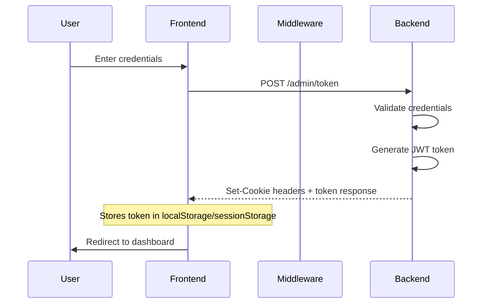
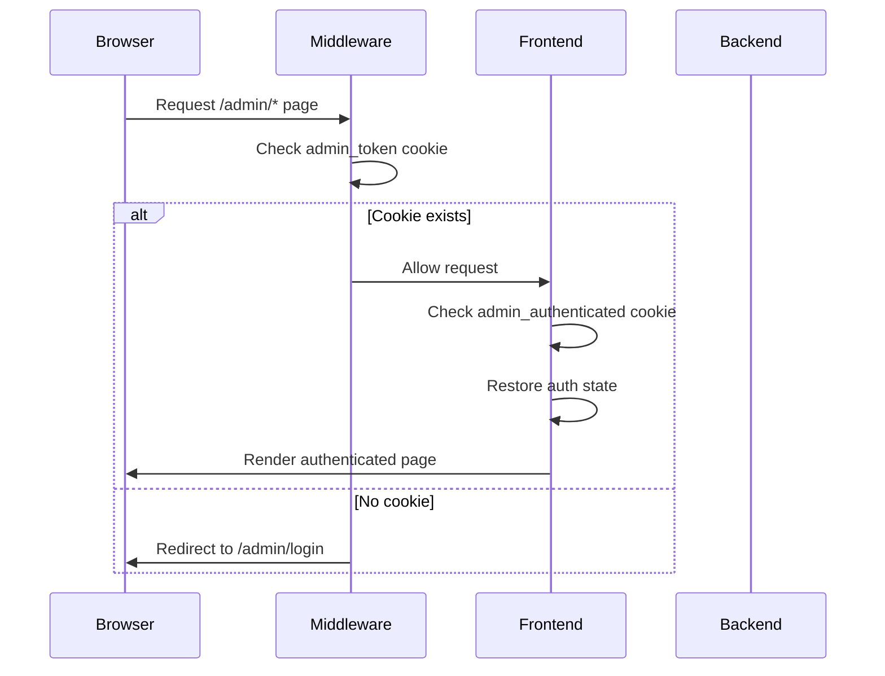

# Authentication System Documentation

## Overview

The Special Wedding platform implements a secure, multi-tenant authentication system using the **Two-Cookie Pattern** with **Middleware-Based Authentication** - following Next.js best practices for server-side authentication. This approach eliminates hydration errors, ensures proper SSR compatibility, and maintains session persistence across page refreshes.

## Table of Contents

1. [Architecture Overview](#architecture-overview)
2. [Two-Cookie Pattern Implementation](#two-cookie-pattern-implementation)
3. [Role Hierarchy](#role-hierarchy)
4. [Authentication Flow](#authentication-flow)
5. [Security Features](#security-features)
6. [Session Management](#session-management)
7. [API Integration](#api-integration)
8. [Testing](#testing)
9. [Troubleshooting](#troubleshooting)

## Architecture Overview

### Technology Stack
- **Frontend**: Next.js 15 with React 19
- **Backend**: FastAPI with Python
- **Token Type**: JWT (JSON Web Tokens)
- **Cookie Management**: Two-cookie pattern for security and usability

### Key Components

```
┌─────────────────┐     ┌─────────────────┐     ┌─────────────────┐
│   Middleware    │────▶│   API Routes    │────▶│    Backend      │
│ (middleware.ts) │     │ (Next.js API)   │     │   (FastAPI)     │
└─────────────────┘     └─────────────────┘     └─────────────────┘
         │                      │                         │
         │                      │                         │
  Server-side auth        Cookie Management        Issues & Validates
  Checks cookies          Sets/Clears cookies        JWT Tokens
  Redirects if needed     Proxies requests

         ▼
┌─────────────────┐
│   Client Side   │
│  (AdminContext) │
└─────────────────┘
         │
         │
  UI State Only
  No routing decisions
```

### Authentication Philosophy

Following Next.js best practices:
1. **Middleware handles ALL authentication decisions** - Never in client components
2. **No client-side route guards** - Prevents hydration errors
3. **Server-side cookie validation** - Security and SSR compatibility
4. **Client context for UI state only** - Not for routing or security

## Two-Cookie Pattern Implementation

The system uses two complementary cookies to manage authentication state:

### 1. `admin_token` Cookie (Secure)
- **Type**: httpOnly cookie
- **Content**: JWT authentication token
- **Accessibility**: Server-side only (cannot be read by JavaScript)
- **Security**: Protected against XSS attacks
- **Expiry**: 7 days (604800 seconds)
- **Usage**: Used by middleware and backend for authentication

### 2. `admin_authenticated` Cookie (State Indicator)
- **Type**: Regular cookie (non-httpOnly)
- **Content**: Simple boolean flag ("true")
- **Accessibility**: Readable by JavaScript
- **Security**: Contains no sensitive data
- **Expiry**: 7 days (same as admin_token)
- **Usage**: Allows client-side code to know authentication state

### Implementation Details

#### Backend Cookie Setting (`app/api/admin_auth.py`)

```python
@router.post("/token", tags=["Auth"])
def login_for_access_token(credentials: AdminLoginModel, response: Response):
    token_data = auth_service.login_and_get_token(credentials.email, credentials.password)

    # TWO-COOKIE PATTERN for secure authentication:

    # 1. Set httpOnly cookie for the actual token (secure, not readable by JS)
    response.set_cookie(
        key="admin_token",
        value=token_data["access_token"],
        max_age=604800,  # 7 days in seconds
        httponly=True,   # Security: prevents XSS attacks
        samesite="lax",  # CSRF protection
        secure=False,    # Set to True in production with HTTPS
        path="/"
    )

    # 2. Set client-readable cookie for auth state (no sensitive data)
    response.set_cookie(
        key="admin_authenticated",
        value="true",    # Simple boolean flag
        max_age=604800,  # Same expiry as token
        httponly=False,  # Client needs to read this
        samesite="lax",
        secure=False,    # Set to True in production with HTTPS
        path="/"
    )

    return token_data
```

#### Client-Side State Management (`app/contexts/AdminContext.tsx`)

```typescript
useEffect(() => {
    // TWO-COOKIE PATTERN:
    // 1. admin_token: httpOnly cookie with actual JWT (not accessible here)
    // 2. admin_authenticated: readable cookie for client auth state

    // Check the client-readable auth cookie
    const match = document.cookie.match(/admin_authenticated=([^;]+)/);
    const cookieAuth = match ? match[1] === 'true' : false;

    if (cookieAuth) {
        setIsAuthenticated(true);
        // Token from localStorage/sessionStorage for API calls
        const storedToken = localStorage.getItem('admin_token') ||
                          sessionStorage.getItem('admin_token');
        if (storedToken) {
            setToken(storedToken);
        }
    }
}, [initialAuth]);
```

## Role Hierarchy

The system supports a multi-tenant architecture with the following role hierarchy:

### 1. ROOT_ADMIN
- **Description**: System administrator (platform owner)
- **Access**: Full system access across all tenants
- **Capabilities**:
  - Manage all wedding planners
  - Access system-wide analytics
  - Configure platform settings
  - Manage subscriptions

### 2. Wedding Planner
- **Description**: Paying customers with subscriptions
- **Access**: Their own weddings and associated data
- **Capabilities**:
  - Create and manage weddings
  - Manage guest lists
  - Configure wedding settings
  - Access analytics for their weddings
  - Manage vendor relationships

### 3. Couples
- **Description**: Associated with specific weddings
- **Access**: Their wedding data only
- **Capabilities**:
  - View wedding details
  - Manage personal information
  - Access wedding website

### 4. Vendors
- **Description**: Service providers for planners
- **Access**: Limited to assigned weddings
- **Capabilities**:
  - View relevant wedding details
  - Update service information
  - Communicate with planners

## Authentication Flow

### Login Process



### Page Refresh Flow



### Logout Process

```python
@router.post("/logout", tags=["Auth"])
def logout(response: Response):
    """Clear both authentication cookies (two-cookie pattern)"""
    # Clear the httpOnly token cookie
    response.delete_cookie(key="admin_token", path="/")
    # Clear the client-readable auth state cookie
    response.delete_cookie(key="admin_authenticated", path="/")
    return {"message": "Logged out successfully"}
```

## Security Features

### 1. XSS Protection
- JWT stored in httpOnly cookie prevents JavaScript access
- No sensitive data in client-readable cookies
- Content Security Policy headers configured

### 2. CSRF Protection
- SameSite=lax cookie attribute
- Token validation on all requests
- Secure headers middleware

### 3. Multi-Tenant Isolation
- Wedding ID validation on all operations
- Role-based access control (RBAC)
- Tenant-scoped data queries

### 4. Token Security
- JWT tokens with configurable expiration
- Secure token generation using secrets
- Token rotation on sensitive operations

### 5. Middleware Protection

```typescript
// middleware.ts
export function middleware(request: NextRequest) {
    if (request.nextUrl.pathname.startsWith('/admin') &&
        !request.nextUrl.pathname.startsWith('/admin/login')) {

        // Check for admin token in cookies
        const token = request.cookies.get('admin_token')?.value;

        if (!token) {
            // Redirect to login if no token
            return NextResponse.redirect(new URL('/admin/login', request.url));
        }
    }
    return NextResponse.next();
}
```

## Session Management

### Session Persistence
The two-cookie pattern ensures sessions persist across:
- Page refreshes
- Browser tab changes
- Browser restarts (if "Remember Me" is selected)

### Session Storage Strategy

| Storage Type | Usage | Content |
|-------------|-------|---------|
| httpOnly Cookie | Primary authentication | JWT token |
| Regular Cookie | Client state indicator | "true" flag |
| localStorage | API requests | JWT token copy (remember me) |
| sessionStorage | API requests | JWT token copy (temporary) |

### Remember Me Feature

```typescript
const login = async (email: string, password: string, rememberMe = true) => {
    // ... login logic ...

    // Store token based on remember me preference
    const storage = rememberMe ? localStorage : sessionStorage;
    storage.setItem('admin_token', access_token);

    // Server sets cookies with appropriate max-age
    setToken(access_token);
    setIsAuthenticated(true);
};
```

## API Integration

### Next.js API Routes (Proxy Layer)

The application uses Next.js API routes as a proxy layer to handle cookie management and cross-origin issues:

#### `/app/api/admin/token/route.ts` - Login Endpoint
```typescript
export async function POST(request: NextRequest) {
    // Forward credentials to backend
    const response = await fetch(`${backendUrl}/admin/token`, {
        method: 'POST',
        headers: { 'Content-Type': 'application/json' },
        body: JSON.stringify(body),
    });

    const data = await response.json();

    // Create response with proper cookie setting
    const res = NextResponse.json(data);

    // Set both cookies using NextResponse
    res.cookies.set('admin_token', token, {
        httpOnly: true,
        secure: process.env.NODE_ENV === 'production',
        sameSite: 'lax',
        path: '/',
        maxAge: 604800 // 7 days
    });

    res.cookies.set('admin_authenticated', 'true', {
        httpOnly: false,
        secure: process.env.NODE_ENV === 'production',
        sameSite: 'lax',
        path: '/',
        maxAge: 604800
    });

    return res;
}
```

#### `/app/api/admin/logout/route.ts` - Logout Endpoint
```typescript
export async function POST(request: NextRequest) {
    // Forward to backend and clear cookies
    const res = NextResponse.json(data);
    res.cookies.delete('admin_token');
    res.cookies.delete('admin_authenticated');
    return res;
}
```

#### `/app/api/admin/profile/route.ts` - Profile Endpoint
```typescript
export async function GET(request: NextRequest) {
    // Get token from cookies
    const cookieStore = await cookies();
    const token = cookieStore.get('admin_token')?.value;

    // Forward request with token to backend
    const response = await fetch(`${backendUrl}/admin/profile`, {
        headers: {
            'Authorization': `Bearer ${token}`,
            'Content-Type': 'application/json',
        },
    });

    return NextResponse.json(data);
}
```

### Client-Side API Requests

All API requests include the JWT token in the Authorization header:

```typescript
const apiRequest = async (path: string, method: string = 'GET', body?: any) => {
    const options: RequestInit = {
        method,
        headers: {
            'Authorization': `Bearer ${token}`,
            'Content-Type': 'application/json',
        },
    };
    // ... rest of request logic
};
```

### Backend Token Validation

```python
# app/dependencies/auth_extended.py
async def get_current_user_extended(
    token: str = Depends(oauth2_scheme)
) -> ExtendedAuthUser:
    # Validate JWT token
    # Check user permissions
    # Return user context with role information
```

## Testing

### Integration Test

A comprehensive test script is provided at `tests/integration/test_auth_session.py`:

```python
def test_login_and_session():
    """Test the login flow and verify cookies are set correctly"""

    # Test login
    response = session.post(f"{BASE_URL}/admin/token", json=login_data)

    # Verify both cookies are set
    cookies = session.cookies.get_dict()
    assert 'admin_token' in cookies
    assert 'admin_authenticated' in cookies

    # Test authenticated request
    profile_response = session.get(f"{BASE_URL}/admin/profile")
    assert profile_response.status_code == 200
```

### Manual Testing Checklist

- [ ] Login successfully sets both cookies
- [ ] Page refresh maintains authentication
- [ ] Logout clears both cookies
- [ ] Protected routes redirect when not authenticated
- [ ] API requests include proper authorization
- [ ] Remember me feature works correctly
- [ ] Session expires after 7 days

## Important Implementation Notes

### ✅ Correct Patterns (Next.js Best Practices)

1. **Middleware-Based Authentication**
```typescript
// middleware.ts - ALL authentication decisions happen here
export function middleware(request: NextRequest) {
    if (request.nextUrl.pathname.startsWith('/admin')) {
        const token = request.cookies.get('admin_token')?.value;
        const authenticated = request.cookies.get('admin_authenticated')?.value;

        if (!token && !authenticated) {
            return NextResponse.redirect(new URL('/admin/login', request.url));
        }
    }
    return NextResponse.next();
}
```

2. **API Route Cookie Setting**
```typescript
// app/api/admin/token/route.ts
const res = NextResponse.json(data);
res.cookies.set('admin_token', token, { httpOnly: true, ... });
res.cookies.set('admin_authenticated', 'true', { ... });
return res;
```

3. **Client Context for UI Only**
```typescript
// AdminContext - Only manages UI state, NO routing
const [isAuthenticated, setIsAuthenticated] = useState(false);
useEffect(() => {
    // Check cookies AFTER mount to avoid hydration issues
    const match = document.cookie.match(/admin_authenticated=([^;]+)/);
    setIsAuthenticated(match?.[1] === 'true');
}, []);
```

### ❌ Anti-Patterns to Avoid

1. **Client-Side Route Guards** (Causes Hydration Errors)
```typescript
// DON'T DO THIS - Causes hydration mismatches
function AdminRouteGuard({ children }) {
    const { isAuthenticated } = useAdmin();
    if (!isAuthenticated) {
        router.push('/login'); // ❌ Client routing decision
    }
    return children;
}
```

2. **Checking Cookies During SSR**
```typescript
// DON'T DO THIS - document is undefined on server
const getInitialAuthState = () => {
    // ❌ This breaks SSR
    const cookie = document.cookie.match(/admin_authenticated/);
    return cookie ? true : false;
};
const [isAuthenticated] = useState(getInitialAuthState());
```

3. **Using cookies() in Client Components**
```typescript
// DON'T DO THIS - cookies() only works in Server Components
'use client';
import { cookies } from 'next/headers';
const token = cookies().get('admin_token'); // ❌ Won't work
```

## Troubleshooting

### Common Issues

#### 1. Hydration Error: "Hydration failed because the server rendered HTML didn't match the client"
**Cause**: Client-side authentication checks during initial render
**Solution**:
- Remove all client-side route guards
- Let middleware handle authentication
- Only check cookies in useEffect after mount

#### 2. Session Lost on Refresh
**Cause**: Client-side route guard redirecting before cookies are checked
**Solution**:
- Remove AdminRouteGuard component
- Ensure middleware checks both cookies
- Verify cookies are set with correct attributes

#### 3. "document is not defined" Error
**Cause**: Trying to access browser APIs during SSR
**Solution**:
- Wrap browser API calls in `typeof document !== 'undefined'` check
- Move cookie checks to useEffect
- Use server components for initial auth state

#### 4. 401 Unauthorized Errors
**Cause**: Token expired or invalid
**Solution**: Check token expiration, ensure proper token storage

#### 5. CORS Issues with Docker
**Cause**: Frontend and backend on different ports
**Solution**: Use Next.js API routes as proxy to backend

#### 6. Cookie Not Being Set
**Cause**: Incorrect Response object usage in API routes
**Solution**: Use `NextResponse` and set cookies on the response object

### Debug Commands

```bash
# Check if servers are running
curl -I http://localhost:3000/admin/login
curl -I http://localhost:8000/docs

# Test login endpoint
curl -X POST http://localhost:8000/admin/token \
  -H "Content-Type: application/json" \
  -d '{"email": "test@example.com", "password": "password"}' \
  -c cookies.txt -v

# Check cookies
cat cookies.txt
```

### Environment Variables

Ensure these are properly configured:

```env
# Frontend (.env.local)
NEXT_PUBLIC_API_BASE_URL=http://localhost:8000

# Backend (.env)
SECRET_KEY=your-secret-key
ACCESS_TOKEN_EXPIRE_MINUTES=10080  # 7 days
```

## Best Practices

1. **Always use HTTPS in production** - Set `secure=true` for cookies
2. **Rotate secrets regularly** - Update SECRET_KEY periodically
3. **Monitor failed login attempts** - Implement rate limiting
4. **Audit authentication logs** - Track login/logout events
5. **Test across browsers** - Ensure cookie handling works everywhere
6. **Implement token refresh** - Before tokens expire
7. **Use secure headers** - CSP, HSTS, X-Frame-Options

## References

- [OWASP Authentication Cheat Sheet](https://cheatsheetseries.owasp.org/cheatsheets/Authentication_Cheat_Sheet.html)
- [Next.js Authentication Guide](https://nextjs.org/docs/app/guides/authentication)
- [JWT Best Practices](https://tools.ietf.org/html/rfc8725)
- [MDN: HTTP Cookies](https://developer.mozilla.org/en-US/docs/Web/HTTP/Cookies)

## Changelog

### Version 2.0 (Current - September 17, 2025)
- **BREAKING CHANGE**: Removed client-side route guards (anti-pattern)
- Implemented proper middleware-based authentication per Next.js best practices
- Fixed hydration errors and SSR compatibility issues
- Updated API routes to use NextResponse for cookie management
- Client context now handles UI state only, not routing decisions
- Documentation updated with correct patterns and anti-patterns

### Version 1.0 (Initial)
- Implemented two-cookie authentication pattern
- Fixed session persistence on page refresh
- Maintained multi-tenant security
- Added comprehensive testing utilities

## Key Takeaways

1. **Middleware is the single source of truth** for authentication in Next.js
2. **Never implement client-side route guards** - they cause hydration errors
3. **API routes must use NextResponse** for proper cookie management
4. **Client components should only manage UI state**, not security decisions
5. **Always check cookies in useEffect** to avoid SSR issues

---

*Last Updated: September 17, 2025*
*Maintained by: Special Wedding Platform Team*