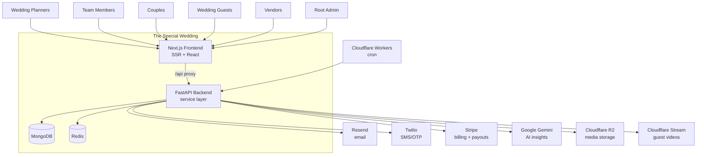

# Architecture

How **The Special Wedding** is built and how its pieces fit together. This is the
high-level, production-oriented view; for what each feature does, see the
[feature documentation](README.md#feature-documentation).

## Overview

The platform is a **multi-tenant SaaS**: one deployment serves many independent wedding
planners, and every record (wedding, guest, budget, vendor, gallery) is scoped and
isolated to its owning planner. It is built as a **modular monolith** — a Next.js
frontend and a FastAPI backend with a clear service layer — designed so individual
modules can later be split into separate services as scale demands.

## System context



## Technology stack

| Layer | Technology |
|-------|------------|
| Frontend | Next.js 16, React 19, TypeScript 5.8, Tailwind CSS 3.4 |
| Backend | FastAPI (Python 3.11), Motor (async MongoDB driver) |
| Database | MongoDB 7.0 |
| Cache / sessions | Redis 7 |
| SMS / OTP | Twilio (Messaging Service + status callbacks) |
| Email | Resend |
| Payments | Stripe (Subscriptions, Checkout, Connect payouts, Webhooks) |
| AI | Google Gemini API |
| Media storage | Cloudflare R2 (S3-compatible) + Cloudflare Stream for video |
| PDF generation | WeasyPrint (seating charts, contracts), python-pptx |
| Push | Web Push (VAPID) |
| Scheduled jobs | Cloudflare Workers (trial expiry, metrics snapshots, backups, uptime) |
| Deployment | Coolify (Docker, single server) |

## Containers & runtime

The current production path builds the Next.js frontend and FastAPI backend into a
**single Docker image** (`Dockerfile.coolify`), with **Supervisor** running both
processes:

- **Frontend** — `next start` on port `3000`. Handles SSR, the guest-facing landing
  pages, and the admin/couple/vendor UIs. Server-side data fetches and the `/api/proxy`
  route forward to the backend.
- **Backend** — Uvicorn on port `8000`. Worker count comes from `WEB_CONCURRENCY`
  (default 2); when Redis is disabled it forces a single worker so Server-Sent Events
  stay correct across workers.
- **MongoDB** — primary document store; collections per domain (weddings, guests, rsvps,
  budget categories, vendor profiles/contracts, tables, forms, subscriptions, etc.).
- **Redis** — sessions, caching, rate limiting, and SSE coordination.

Scheduled work runs **outside** the container as Cloudflare Workers that call secured
backend endpoints (trial expiry, metrics snapshots, backups, uptime checks).

## Request & data flow

1. A browser hits the **Next.js** app. Public wedding pages render server-side; admin and
   portal apps are React client apps.
2. Client and server calls go through the frontend's **`/api` proxy** to the **FastAPI**
   backend.
3. The backend authenticates the request, enforces **role** and **plan/feature gates**,
   and delegates to the **service layer**.
4. Services read/write **MongoDB**, use **Redis** for caching/sessions, and call external
   providers (Twilio, Resend, Stripe, Gemini, Cloudflare R2/Stream) as needed.
5. Real-time updates (new RSVPs, messages, data changes) stream to the UI over
   **Server-Sent Events**.

## Code structure

```
app/
  [slug]/        Guest-facing wedding pages (landing, gallery, RSVP)
  admin/         Planner & root-admin UIs (dashboard, guests, budget, seating, vendors,
                 forms, gallery, calendar, platform, saas, billing, team, …)
  couple/        Couple portal (dashboard, registry, FAQ, memories)
  api/           FastAPI route handlers
  services/      Business logic layer (guest, budget, vendor, forms, billing, …)
  models/        Pydantic models / MongoDB schemas
  core/          Settings, database, indexes, cache, container
  dependencies/  Auth and feature-gate dependencies
  components/    Shared React components
  contexts/      React contexts (Auth, Theme, Wedding)

cloudflare-workers/  Cron workers (trial, metrics, backup, uptime)
scripts/             Seed/setup/maintenance scripts
docs/                This documentation
```

## Identity, roles & multi-tenancy

Authentication is JWT-based with **HttpOnly session cookies**. Authorization is layered:

- **Role** — Root Admin, Planner, Team Member, Couple, Guest, Vendor.
- **Tenant isolation** — planners only ever see their own weddings and data.
- **Team permissions** — team members are gated per capability (manage guests, budget,
  seating, vendors, …).
- **Plan/feature gates** — subscription plans unlock features (vendor management,
  seating, calendar sync, AI, analytics) and seat counts.
- **Token-based guest/vendor access** — guests verify via OTP for private weddings;
  vendors open contracts via signed token links without an account.

## Security & operations

- Secrets are supplied via environment variables (Coolify dashboard / `.env`); none are
  committed.
- Rate limiting protects auth and general endpoints; security headers and input
  sanitization are applied at the edge of the API.
- **Audit logging** records sensitive actions with TTL-based auto-cleanup.
- **Health checks** cover the database and every external service and feed the Root Admin
  monitoring views.
- Stripe and email webhooks are signature-verified.

## Deployment & promotion

- **Staging** auto-deploys after CI.
- **Production** is promoted manually by immutable image SHA.
- Deploy verification and rollback logic are shared across the deploy workflows.

The recommended next step is a **split-service** rollout (frontend and backend as
separate Coolify services) — see the [roadmap](ROADMAP.md).
