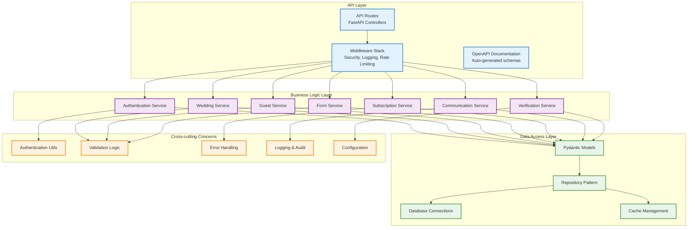

# Component Architecture - Wedding WebApp

## Overview

The Wedding WebApp follows a layered component architecture with clear separation of concerns. The system is organized into distinct layers for presentation, business logic, data access, and cross-cutting concerns.

## Backend Component Architecture



## Frontend Component Architecture

```mermaid
graph TB
 %% Presentation Layer
 subgraph "Page Components"
 LP[Landing Pages]
 AD[Admin Dashboard]
 WD[Wedding Detail]
 GV[Guest Verification]
 FB[Form Builder]
 end

 %% Feature Components
 subgraph "Feature Components"
 WM[Wedding Management]
 GM[Guest Management]
 RM[RSVP Management]
 FM[Form Management]
 UM[User Management]
 SM[Subscription Management]
 end

 %% Shared Components
 subgraph "Shared Components"
 UI[UI Components<br/>Button, Modal, Form]
 LO[Layout Components<br/>Header, Sidebar, Footer]
 CH[Chart Components<br/>Analytics, Metrics]
 UP[Upload Components<br/>File, Image handling]
 end

 %% Context & State
 subgraph "State Management"
 AC[Admin Context]
 WC[Wedding Context]
 TC[Theme Context]
 UC[User Context]
 end

 %% Hooks & Utilities
 subgraph "Hooks & Utils"
 API[API Hooks<br/>Data fetching]
 VAL[Validation Hooks<br/>Form validation]
 UTIL[Utility Functions<br/>Formatting, helpers]
 RT[Route Guards<br/>Authentication checks]
 end

 %% Dependencies
 LP --> LO
 AD --> WM
 AD --> GM
 AD --> SM
 WD --> RM
 GV --> FM
 FB --> FM

 WM --> UI
 GM --> UI
 RM --> UI
 FM --> UI
 UM --> UI
 SM --> UI

 WM --> AC
 GM --> WC
 RM --> WC
 FM --> UC
 UM --> AC
 SM --> AC

 WM --> API
 GM --> API
 RM --> VAL
 FM --> VAL
 UM --> RT
 SM --> UTIL

 %% Styling
 classDef pageClass fill:#e3f2fd,stroke:#1976d2,stroke-width:2px
 classDef featureClass fill:#f3e5f5,stroke:#7b1fa2,stroke-width:2px
 classDef sharedClass fill:#e8f5e8,stroke:#388e3c,stroke-width:2px
 classDef stateClass fill:#fff3e0,stroke:#f57c00,stroke-width:2px
 classDef utilClass fill:#fce4ec,stroke:#c2185b,stroke-width:2px

 class LP,AD,WD,GV,FB pageClass
 class WM,GM,RM,FM,UM,SM featureClass
 class UI,LO,CH,UP sharedClass
 class AC,WC,TC,UC stateClass
 class API,VAL,UTIL,RT utilClass
```



## Backend Component Details

### 1. API Layer Components

#### API Routes (`app/api/`)
**Responsibility**: HTTP request handling and response formatting
**Key Files**:
- `admin_auth.py` - Authentication endpoints
- `wedding.py` - Wedding management endpoints
- `guest.py` - Guest management endpoints
- `forms.py` - Form builder endpoints
- `subscription_management.py` - Billing endpoints

**Design Patterns**:
- **Controller Pattern**: Thin controllers delegating to services
- **Dependency Injection**: FastAPI dependency system
- **Decorator Pattern**: Route protection and validation

```python
# Example API endpoint structure
@router.post("/weddings", response_model=WeddingResponse)
async def create_wedding(
 wedding_data: WeddingCreate,
 current_user: ExtendedAuthUser = Depends(require_wedding_planner),
 wedding_service: WeddingService = Depends(get_wedding_service)
) -> WeddingResponse:
 return await wedding_service.create_wedding(wedding_data, current_user)
```

#### Middleware Stack (`app/middleware/`)
**Components**:
1. **ErrorHandlerMiddleware** - Global exception handling
2. **SecurityHeadersMiddleware** - Security headers injection
3. **CSRFProtectionMiddleware** - CSRF token validation
4. **AuditLoggingMiddleware** - Request/response auditing
5. **PerformanceMonitoringMiddleware** - Performance metrics
6. **RateLimitMiddleware** - Request rate limiting

**Order of Execution** (outermost to innermost):
```
Request → Error Handler → Security Headers → CSRF → Audit → Performance → Rate Limit → CORS → Compression → Application
```

### 2. Business Logic Layer

#### Authentication Service (`app/services/auth_service.py`)
**Responsibilities**:
- JWT token generation and validation
- User authentication and authorization
- Role-based access control
- Session management

**Key Methods**:
```python
async def authenticate_user(email: str, password: str) -> Optional[AuthUser]
async def create_access_token(user: AuthUser) -> str
async def verify_token(token: str) -> Optional[AuthUser]
async def check_permissions(user: AuthUser, resource: str) -> bool
```

#### Wedding Service (`app/services/wedding_service.py`)
**Responsibilities**:
- Wedding lifecycle management
- Privacy settings and access control
- Wedding data validation and processing
- Multi-tenant data isolation

**Key Methods**:
```python
async def create_wedding(wedding_data: WeddingCreate, user: AuthUser) -> Wedding
async def get_user_weddings(user_id: str) -> List[Wedding]
async def update_privacy_settings(wedding_id: str, settings: PrivacySettings) -> Wedding
async def verify_wedding_access(wedding_id: str, user: AuthUser) -> bool
```

#### Guest Service (`app/services/guest_service.py`)
**Responsibilities**:
- Guest list management
- Guest verification and authentication
- RSVP processing and tracking
- Plus-one management

#### Form Service (`app/services/form_service.py`)
**Responsibilities**:
- Dynamic form creation and management
- Form template system
- Response collection and analysis
- Form distribution and tracking

#### Subscription Service (`app/services/subscription_service.py`)
**Responsibilities**:
- Subscription plan management
- Usage tracking and limits enforcement
- Feature gating based on subscription tier
- Billing integration and webhooks

### 3. Data Access Layer

#### Pydantic Models (`app/models/`)
**Purpose**: Type-safe data models with validation
**Key Models**:
- `User` - User account and profile information
- `Wedding` - Wedding details and settings
- `Guest` - Guest information and contact details
- `RSVP` - RSVP responses and status
- `Form` - Dynamic form definitions
- `Subscription` - Subscription plans and usage

**Example Model Structure**:
```python
class Wedding(BaseModel):
 id: Optional[PyObjectId] = Field(alias="_id", default=None)
 title: str = Field(..., min_length=1, max_length=200)
 slug: str = Field(..., regex=r'^[a-z0-9-]+$')
 date: date
 privacy_mode: PrivacyMode = PrivacyMode.private
 created_by: str
 created_at: datetime = Field(default_factory=datetime.utcnow)
 class Config:
 populate_by_name = True
 json_encoders = {ObjectId: str}
```

#### Repository Pattern (`app/services/`)
**Purpose**: Abstract data access operations
**Benefits**:
- Testable business logic
- Database technology independence
- Consistent error handling
- Connection pooling management

### 4. Cross-cutting Concerns

#### Configuration Management (`app/core/settings.py`)
**Responsibilities**:
- Environment-based configuration
- Feature flag management
- Secure credential handling
- Runtime configuration validation

```python
class Settings(BaseSettings):
 app_name: str = "Wedding WebApp"
 environment: str = "development"
 secret_key: str
 database_url: str
 redis_url: Optional[str] = None
 # Feature flags
 csrf_enabled: bool = True
 rate_limit_enabled: bool = True
 audit_logging_enabled: bool = True
 class Config:
 env_file = ".env"
```

#### Error Handling (`app/middleware/error_handler.py`)
**Strategy**:
- Centralized exception handling
- Structured error responses
- Security-conscious error messages
- Comprehensive error logging

**Error Response Format**:
```json
{
 "error": {
 "code": "VALIDATION_ERROR",
 "message": "Invalid input data",
 "details": {
 "field": "email",
 "issue": "Invalid email format"
 },
 "timestamp": "2025-08-22T10:30:00Z"
 }
}
```

## Frontend Component Details

### 1. Page Components

#### Admin Dashboard (`app/admin/`)
**Structure**:
```
admin/
 layout.tsx # Admin layout with navigation
 page.tsx # Dashboard overview
 weddings/ # Wedding management pages
 guests/ # Guest management pages
 forms/ # Form builder pages
 settings/ # Configuration pages
 users/ # User management (ROOT_ADMIN)
```

**Key Features**:
- Role-based navigation
- Real-time data updates
- Responsive design
- Accessibility compliance

#### Guest Verification (`app/[slug]/`)
**Components**:
- `GuestVerificationModal.tsx` - Privacy-focused access control
- `WeddingAccessGuard.tsx` - Route protection
- `GuestInfoForm.tsx` - Guest information collection

### 2. Shared Component Library

#### UI Components (`components/ui/`)
**Design System Components**:
```typescript
// Example UI component structure
interface ButtonProps {
 variant: 'primary' | 'secondary' | 'danger'
 size: 'sm' | 'md' | 'lg'
 disabled?: boolean
 loading?: boolean
 children: React.ReactNode
}

export const Button: React.FC<ButtonProps> = ({ ... }) => {
 // Component implementation with Tailwind CSS
}
```

#### Form Components (`components/forms/`)
**Dynamic Form System**:
- `FormBuilder.tsx` - Drag-and-drop form creator
- `FormRenderer.tsx` - Dynamic form rendering
- `FormValidation.tsx` - Client-side validation
- `FormSubmission.tsx` - Submission handling

### 3. State Management

#### Context Architecture
**Global State Contexts**:
- **AdminContext**: User authentication and profile
- **WeddingContext**: Current wedding selection and data
- **ThemeContext**: UI theme and customization
- **NotificationContext**: Toast notifications and alerts

**State Management Pattern**:
```typescript
// Example context structure
interface AdminContextType {
 user: AuthUser | null
 isAuthenticated: boolean
 permissions: Permission[]
 login: (credentials: LoginCredentials) => Promise<void>
 logout: () => void
 updateProfile: (profile: UserProfile) => Promise<void>
}
```

#### Local State Management
**React Hook Form Integration**:
- Form state management with validation
- Optimistic updates for better UX
- Error boundary implementation
- Loading state management

## Component Communication

### 1. Inter-Component Communication

#### Backend Service Communication
```python
# Dependency injection pattern
class WeddingService:
 def __init__(
 self,
 guest_service: GuestService,
 notification_service: NotificationService,
 subscription_service: SubscriptionService
 ):
 self.guest_service = guest_service
 self.notification_service = notification_service
 self.subscription_service = subscription_service
```

#### Frontend Component Communication
```typescript
// Context-based communication
const useWeddingManagement = () => {
 const { currentWedding, updateWedding } = useWedding()
 const { sendNotification } = useNotification()
 const handleWeddingUpdate = async (data: WeddingUpdate) => {
 await updateWedding(data)
 sendNotification('Wedding updated successfully', 'success')
 }
 return { handleWeddingUpdate }
}
```

### 2. Event-Driven Communication

#### Domain Events (Backend)
```python
# Event publishing pattern
class WeddingService:
 async def create_wedding(self, wedding_data: WeddingCreate) -> Wedding:
 wedding = await self.repository.create(wedding_data)
 # Publish domain event
 await self.event_publisher.publish(
 WeddingCreatedEvent(
 wedding_id=wedding.id,
 user_id=wedding.created_by,
 timestamp=datetime.utcnow()
 )
 )
 return wedding
```

#### Real-time Updates (Frontend)
```typescript
// WebSocket/Server-Sent Events for real-time updates
const useRealTimeUpdates = (weddingId: string) => {
 useEffect(() => {
 const eventSource = new EventSource(`/api/weddings/${weddingId}/events`)
 eventSource.onmessage = (event) => {
 const update = JSON.parse(event.data)
 // Update local state based on real-time events
 }
 return () => eventSource.close()
 }, [weddingId])
}
```

## Quality Attributes

### 1. Testability
- **Unit Tests**: Service layer isolation with mocking
- **Integration Tests**: API endpoint testing with test database
- **E2E Tests**: Playwright-based user journey testing
- **Component Tests**: React component testing with Testing Library

### 2. Maintainability
- **Clear Separation**: Distinct layers with defined responsibilities
- **Consistent Patterns**: Standardized component and service patterns
- **Documentation**: Comprehensive inline and external documentation
- **Code Standards**: Linting and formatting with automated checks

### 3. Performance
- **Lazy Loading**: Component and route-based code splitting
- **Caching**: Multi-layer caching strategy
- **Optimization**: Bundle optimization and tree shaking
- **Monitoring**: Performance metrics and alerting

### 4. Security
- **Input Validation**: Multi-layer validation (frontend, API, database)
- **Authorization**: Role-based access control throughout
- **Data Protection**: Encryption at rest and in transit
- **Audit Logging**: Comprehensive activity tracking

---

**Next**: [Technology Stack](./04-technology-stack.md)
**Previous**: [Container Architecture](./02-container-architecture.md)
