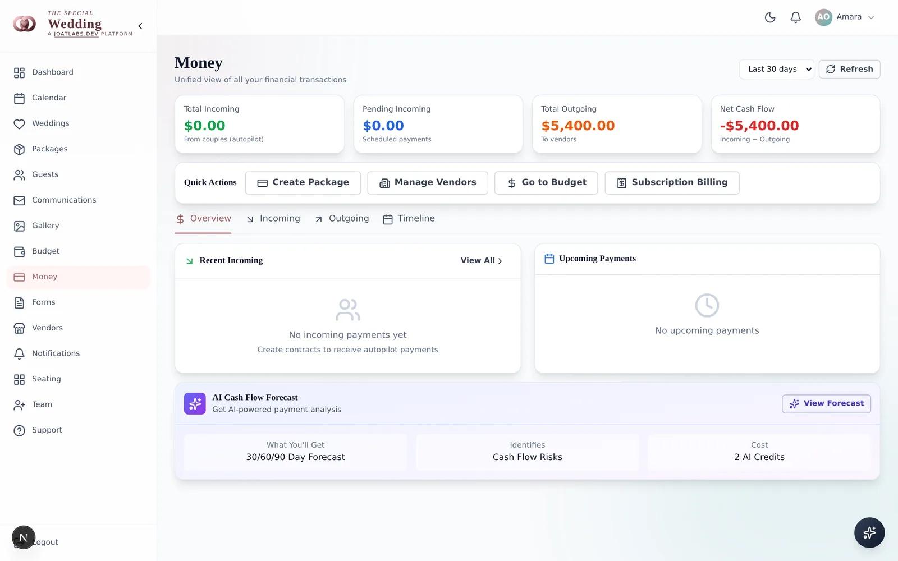

# AI Insights

Google Gemini–powered assistance woven through the planning workspace — budget analysis,
dashboard insights, seating optimization, cash-flow forecasting, vendor guidance, and
message drafting.

## What it is

AI Insights is not a single screen but a set of capabilities surfaced where they're most
useful, powered by the **Google Gemini API**. Usage is metered against the plan's **AI
credit** allowance.

| Where | What the AI does |
|-------|------------------|
| **[Planner Dashboard](planner-dashboard.md)** | Generates at-a-glance insights about the planner's weddings. |
| **[Budget Tracking](budget-tracking.md)** | "AI Insights" analyzes the budget for risks and savings. |
| **[Payments & Finance Autopilot](payments-and-finance-autopilot.md)** | 30/60/90-day cash-flow forecast and risk flags. |
| **[Seating Charts](seating-charts.md)** | "AI Suggest" proposes an optimized seating layout. |
| **[Vendors & Contracts](vendors-and-contracts.md)** | Vendor recommendations and quote-price analysis; contract drafting. |
| **[Service Packages](service-packages.md)** | AI pricing suggestions from services, location, and size. |
| **[Communications & Reminders](communications-and-reminders.md)** | "Draft with AI" writes reminder copy. |

## Works with

Every feature listed above. Credit consumption and availability are governed by
**[Billing & Subscriptions](billing-and-subscriptions.md)**.

## How to use it

1. Make sure your plan includes **AI features** and you have **AI credits** remaining (see Billing → Usage).
2. Trigger AI from the relevant feature — e.g. **AI Insights** on the budget, **AI Suggest** in seating, **View Forecast** in Money, **Draft with AI** in reminders.
3. Review the AI output, then accept, edit, or discard it. Each run consumes credits per the action's cost.

## Roles & access

**Planners** (and permitted **Team Members**). AI features are plan-gated and metered by
credits.
