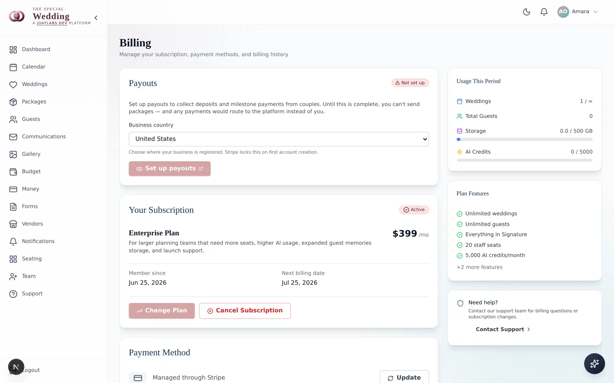

# Billing & Subscriptions

Manage the planner's own subscription, payment method, payouts, and usage — powered by
Stripe.

## What it is

The Billing page is where a planner manages their relationship with the platform. It
shows the current **subscription** (plan, price, status, member-since and next-billing
dates), a **payment method** managed through Stripe, **usage this period** (weddings,
guests, storage, AI credits), and the **plan features**. It's also where the planner
sets up **payouts** (Stripe Connect) so couples can pay them. Plans range from a free
**Solo** tier up to **Boutique**, **Signature**, and **Enterprise**, each unlocking more
features and seats.

## Works with

- **[Team Management](team-management.md)** — the plan sets the number of staff seats.
- **[Payments & Finance Autopilot](payments-and-finance-autopilot.md)** / **[Service Packages](service-packages.md)** — payouts must be connected before packages can be sent to couples.
- **[AI Insights](ai-insights.md)** — AI features draw on the plan's AI credit allowance.
- **Feature gating across the app** — vendor management, seating, calendar sync, and analytics are unlocked by plan.

## How to use it

1. Open **Billing** (under the planner menu).
2. Review **Your Subscription** — plan, price, and next billing date. Use **Change Plan** to upgrade/downgrade or **Cancel Subscription**.
3. Set up **Payouts**: choose your business country and connect Stripe so you can collect deposits and milestone payments from couples.
4. Add or **Update** your **payment method** (managed through Stripe).
5. Monitor **Usage This Period** against your plan's limits, and upgrade if you're approaching them.

## Roles & access

The **Planner** (account owner). Plan assignment and platform-wide plan configuration are
handled by the **Root Admin** in [Platform Administration](platform-administration.md).
