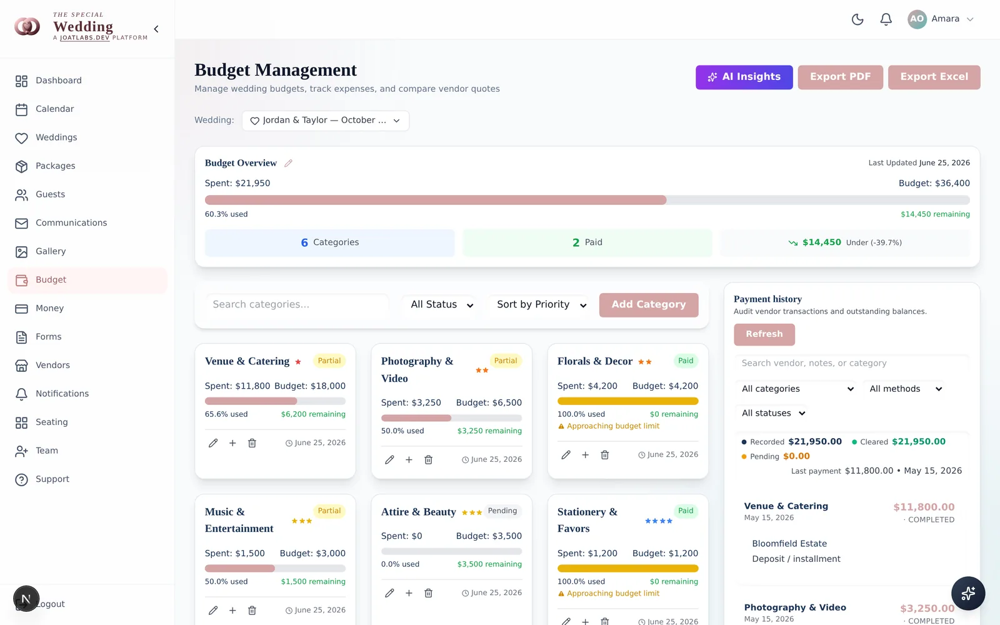

# Budget Tracking

Category-based budgeting with spend tracking, vendor-quote comparison, payment history,
and budget alerts.

## What it is

Budget Tracking gives each wedding a budget broken into categories (venue, photography,
florals, music, attire, stationery, and so on). A top **overview** bar shows total
budgeted, total spent, and remaining. Each category card tracks its budgeted amount,
spent amount, priority, and status (paid / partial / approaching limit), and records a
**payment history** of vendor transactions. Budgets export to **PDF** and **Excel**, and
**AI Insights** can analyze the budget for risks and savings.

## Works with

- **[Vendors & Contracts](vendors-and-contracts.md)** — vendor quotes and contract payments populate categories.
- **[Payments & Finance Autopilot](payments-and-finance-autopilot.md)** — recorded payments feed the cash-flow view.
- **[AI Insights](ai-insights.md)** — the **AI Insights** button on the budget analyzes the plan.
- **[Weddings](weddings.md)** — each budget is scoped to a wedding.

## How to use it

1. Open **Budget** and select the **wedding**.
2. Click **Add Category** and set its **name**, **budgeted amount**, and **priority**. Repeat for each spending area (or apply a template).
3. On a category, **record a payment**: enter the vendor, amount, method, and date. The category's spent/remaining and the overall overview update automatically.
4. Watch for **approaching-limit** and **over-budget** flags on category cards.
5. Click **AI Insights** for an analysis, and **Export PDF**/**Export Excel** to share with the couple.

## Roles & access

**Planners** and permitted **Team Members**. The couple can view budget summaries where
the planner shares them. Advanced budget/AI features are plan-gated.
