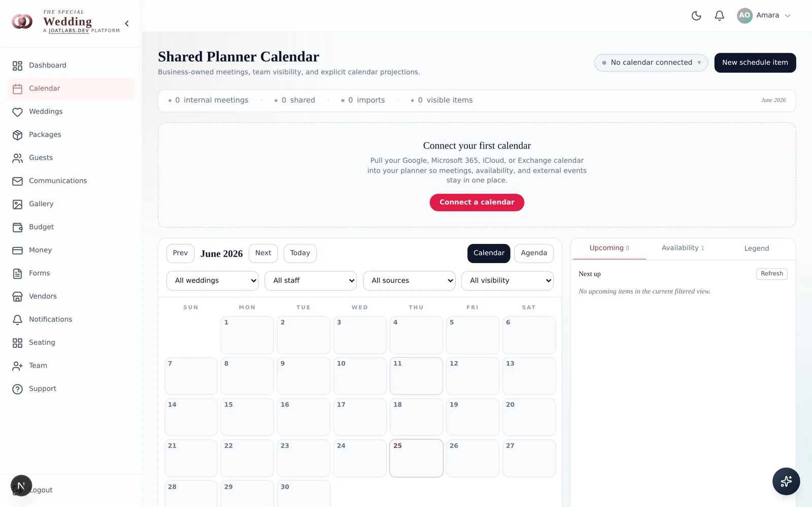

# Calendar

A shared planner calendar that pulls in meetings, availability, and external events, with
two-way Google Calendar sync and ICS export.

## What it is

The Calendar gives the planning business one place for internal meetings, team
visibility, and external calendar events. It connects to **Google**, **Microsoft 365**,
**iCloud**, or **Exchange** so meetings, availability, and external events stay in one
view. It offers month and agenda views, filters by wedding/staff/source/visibility, an
**Upcoming** and **Availability** panel, and **ICS** downloads with correct timezone
handling. Google Calendar sync is two-way.

## Works with

- **[Team Management](team-management.md)** — staff visibility and per-staff filtering.
- **[Weddings](weddings.md)** — schedule items can be associated with a wedding.
- **[Notifications](notifications.md)** — upcoming items can surface as reminders.

## How to use it

1. Open **Calendar** from the sidebar.
2. Click **Connect a calendar** and authorize Google, Microsoft 365, iCloud, or Exchange.
3. Add a meeting or task with **New schedule item**, choosing its wedding, staff, and visibility.
4. Switch between **Calendar** and **Agenda** views, and use the filters (weddings, staff, sources, visibility) to focus.
5. Use the **Availability** tab to find open time, and export events as **ICS** when needed.

## Roles & access

**Planners** and **Team Members** (visibility is permission- and filter-controlled).
Calendar sync is a plan-gated feature.
