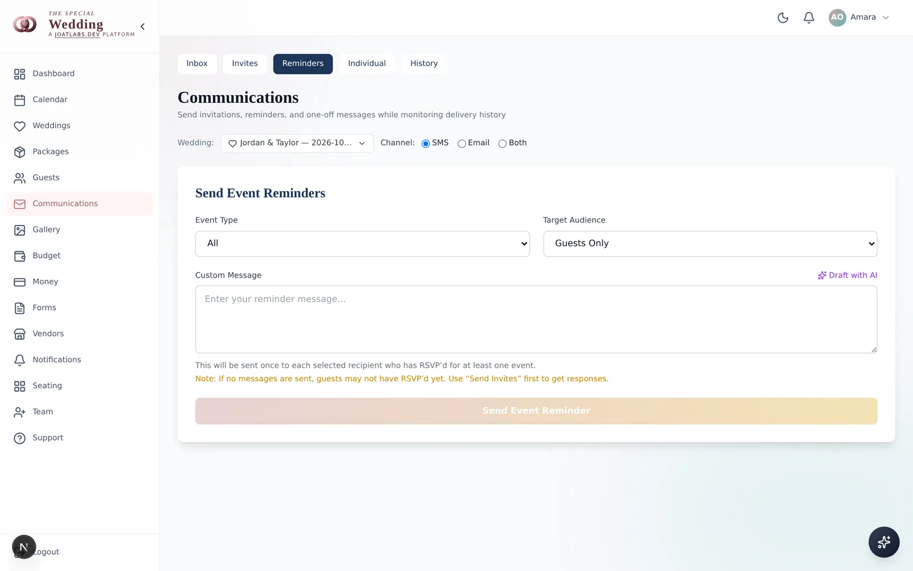

# Communications & Reminders

Send invitations, event reminders, and one-off messages by SMS and email — and monitor
delivery — all from one place.

## What it is

The Communications hub groups every outbound message for a wedding into tabs:

- **Inbox** — replies and incoming messages.
- **Invites** — send the initial RSVP invitations.
- **Reminders** — bulk event reminders to a target audience (e.g. guests who have RSVP'd).
- **Individual** — a one-off message to a single guest.
- **History** — a delivery log for auditing what was sent and whether it arrived.

Messages go out over **Twilio** (SMS) and **Resend** (email); a channel selector lets
you choose SMS, Email, or both. Delivery is tracked via status callbacks, and an
**AI draft** helper can write reminder copy for you.

## Works with

- **[Guest Management](guest-management.md)** — recipients and their opt-in status come from the guest list.
- **[RSVP System](rsvp-system.md)** — invitations start the RSVP flow; OTP codes ride the same channels.
- **[Notifications](notifications.md)** — delivery health and failures surface to the planner.
- **[Planner Dashboard](planner-dashboard.md)** — "Send Reminders" deep-links here.

## How to use it

1. Open **Communications** and select the **wedding** and **channel** (SMS, Email, or Both).
2. To invite guests, use the **Invites** tab.
3. To send a reminder, open **Reminders**, choose the **event type** and **target audience** (e.g. Guests Only), and write a message — or click **Draft with AI**.
4. Click **Send Event Reminder**. Each eligible recipient receives the message once.
5. Use **Individual** for a single guest, and **History** to confirm delivery.

## Notes

If no invitations have been sent yet, guests may not have RSVP'd — send **Invites**
first so reminders have responders to target.

## Roles & access

**Planners** and permitted **Team Members**. Opt-out handling is respected automatically.
