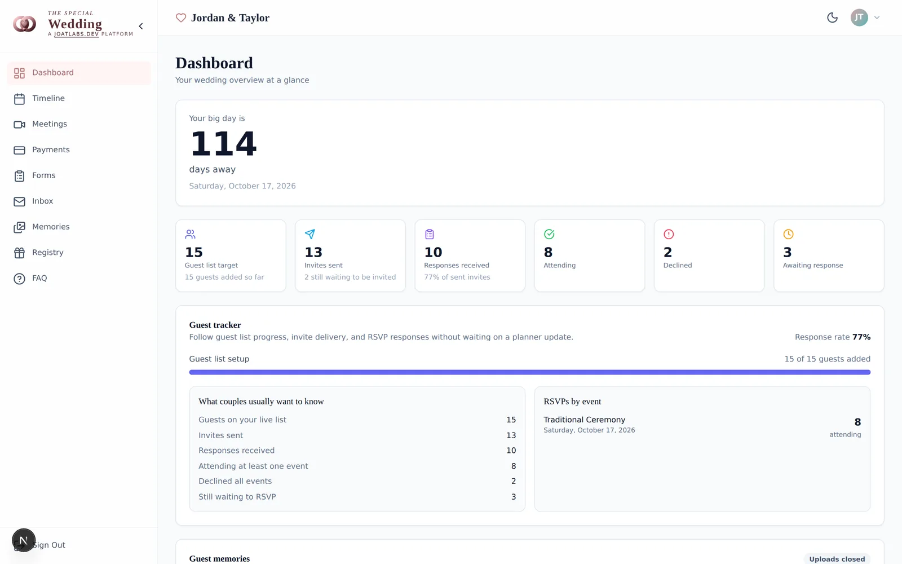
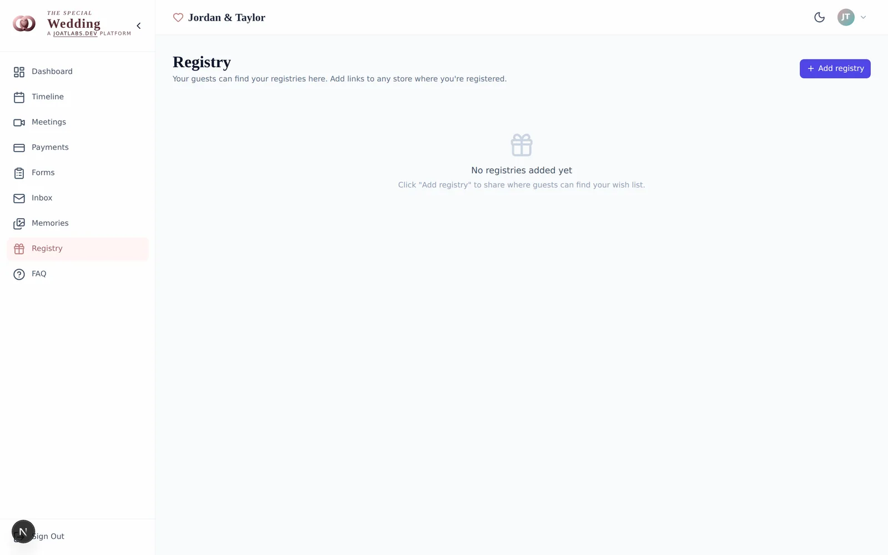
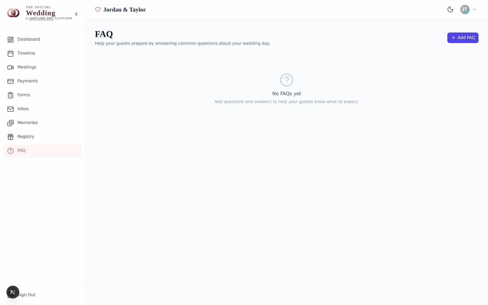
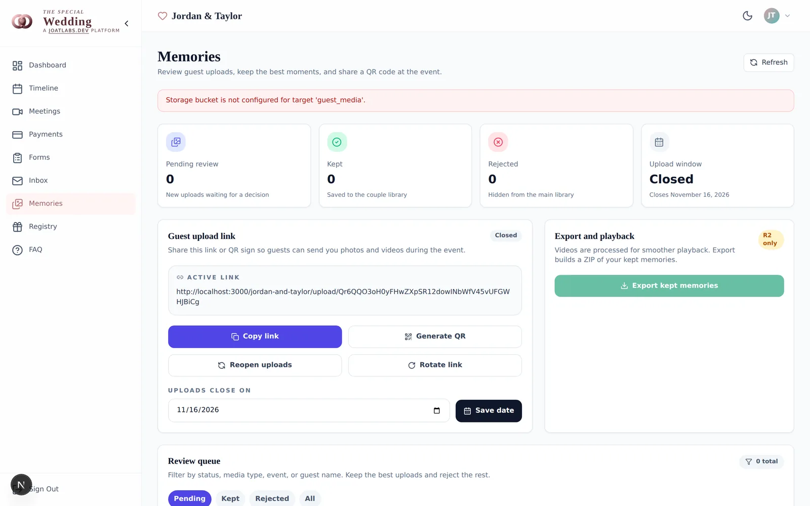

# Couple Portal

A dedicated space for the couple to follow their wedding's progress, manage their
registry and FAQ, and curate guest memories — without touching the planner's workspace.

## What it is

The Couple Portal is the client-facing experience. After a planner invites them, the
couple signs in at `/couple/login` and lands on a dashboard with a countdown to the big
day and a live **guest tracker** (guests added, invites sent, responses received,
attending, declined, awaiting). From the sidebar they reach Timeline, Meetings, Payments,
Forms, Inbox, Memories, Registry, and FAQ.

### Registry

Couples add and manage their gift registry, which appears on the wedding landing page.

### FAQ

Couples maintain the FAQ guests see on the landing page.

### Memories

Couples privately review guest-uploaded photos and videos, keeping or rejecting each.

## Works with

- **[Guest Management](guest-management.md)** / **[RSVP System](rsvp-system.md)** — the guest tracker mirrors the planner's live data (read-only for the couple).
- **[Guest Memories](guest-memories.md)** — the couple's keep/reject review happens here.
- **[Wedding Landing Pages](wedding-landing-pages.md)** — Registry and FAQ content flows to the public site.
- **[Service Packages](service-packages.md)** / **[Payments & Finance Autopilot](payments-and-finance-autopilot.md)** — the couple views and pays packages under Payments.

## How to use it

1. The planner enables the couple portal on the wedding and invites the couple.
2. The couple completes setup and signs in at `/couple/login`.
3. On the **Dashboard**, they watch the countdown and guest tracker.
4. They manage **Registry** and **FAQ** content (which appears on the landing page).
5. Under **Memories**, they review guest uploads and keep or reject each.
6. Under **Payments** and **Forms**, they handle anything the planner has sent them.

## Roles & access

The **Couple** only. Couples never see other weddings or the planner's admin tools.
