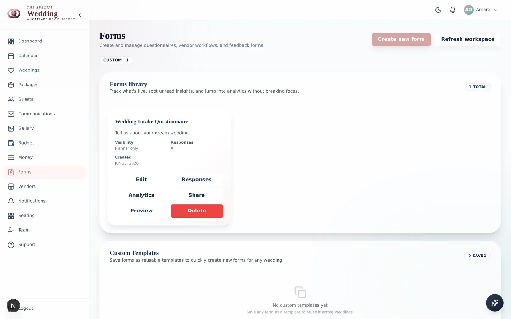

# Form Builder

Build custom questionnaires, vendor-intake forms, and feedback forms, then send them,
collect responses, and review analytics.

## What it is

The Forms area lets a planner create custom forms from a library of field types (text,
date, number, select, textarea, and more). Forms have a type (general, vendor intake,
RSVP-custom, feedback, and others) and can be tied to a wedding. Once live, a form can
be **sent** to recipients, collect **responses**, expose **analytics**, be **shared**
via link, **previewed**, and saved as a reusable **template**.

## Works with

- **[Vendors & Contracts](vendors-and-contracts.md)** — vendor-intake form data can pre-fill contracts.
- **[Guest Management](guest-management.md)** / **[RSVP System](rsvp-system.md)** — custom RSVP and guest-feedback forms complement the built-in flow.
- **[Communications & Reminders](communications-and-reminders.md)** — forms are distributed by email.
- **[Weddings](weddings.md)** — forms can be scoped to a wedding.

## How to use it

1. Open **Forms** and click **Create new form**.
2. Give the form a **name** and **type**, then add **fields** from the builder; mark which are required and add options for select fields.
3. Save the form. It appears in the **Forms library** with its visibility and response count.
4. From a form's actions, **Send** it to recipients, **Share** a link, or **Preview** it.
5. Review **Responses** and **Analytics** as submissions arrive; save the form as a **template** to reuse across weddings.

## Roles & access

**Planners** and permitted **Team Members** build and send forms; recipients (guests or
vendors) fill them out via public links.
