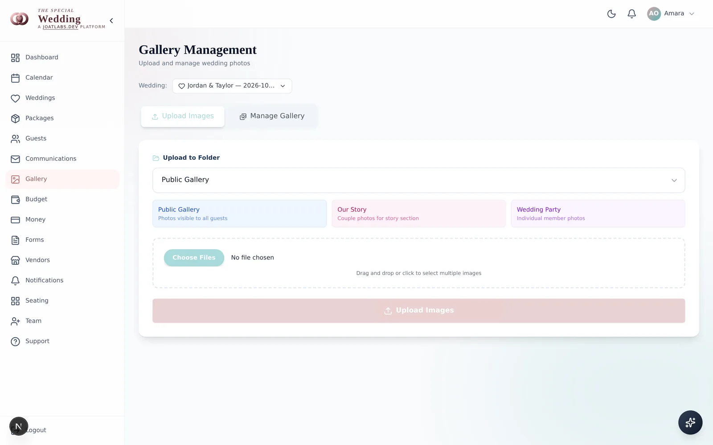

# Gallery

Upload and manage a wedding's photos, organized into guest-facing folders and stored on
Cloudflare R2 with privacy-aware access.

## What it is

The Gallery lets a planner upload and organize wedding photos into folders —
**Public Gallery** (visible to all guests), **Our Story** (couple photos for the story
section), and **Wedding Party** (individual member photos). Media is stored on
**Cloudflare R2** and served from a media domain; uploads use presigned URLs, and access
respects the wedding's privacy settings. Approved photos appear in the Gallery section
of the public landing page.

## Works with

- **[Wedding Landing Pages](wedding-landing-pages.md)** — the Public Gallery and Our Story sections render these images.
- **[Guest Memories](guest-memories.md)** — guest-uploaded photos/videos are a separate, review-gated media stream.
- **[Weddings](weddings.md)** — galleries are scoped per wedding and follow its privacy mode.

## How to use it

1. Open **Gallery** and select the **wedding**.
2. Choose the destination **folder** (Public Gallery, Our Story, or Wedding Party).
3. **Choose Files** or drag-and-drop images into the upload area, then click **Upload Images**.
4. Use **Manage Gallery** to reorder, move, or remove photos.
5. Preview the result in the public landing page's **Gallery** section.

## Roles & access

**Planners** and permitted **Team Members** upload and manage; **Guests** view per the
wedding's privacy settings.
