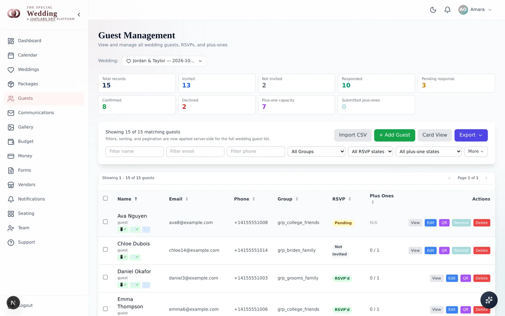
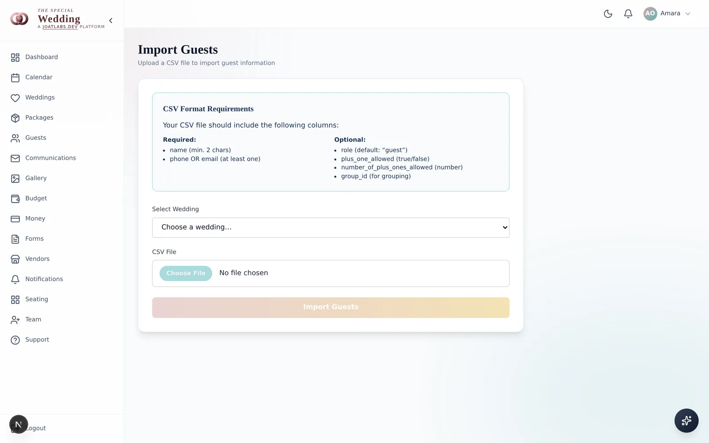

# Guest Management

The complete guest list for a wedding — add, import, and track every guest, their RSVP
state, contact details, and plus-ones.

## What it is

Guest Management is the planner's view of all guests for a wedding. Summary cards show
total records, invited, not invited, responded, pending, confirmed, declined, plus-one
capacity, and submitted plus-ones. The table lists each guest with their group, RSVP
status, plus-ones, and per-row actions (View, Edit, QR, Resend, Delete). Guests can be
filtered by name, email, phone, group, RSVP state, and plus-one state.

### CSV import

Large guest lists can be brought in from a spreadsheet rather than entered by hand.

## Works with

- **[RSVP System](rsvp-system.md)** — RSVP states (confirmed/declined/pending) are tracked per guest.
- **[Communications & Reminders](communications-and-reminders.md)** — invites and reminders are sent to these guests.
- **[Seating Charts](seating-charts.md)** — guests are assigned to tables from this list.
- **[Wedding Landing Pages](wedding-landing-pages.md)** — each guest can receive a personalized invitation link, and QR codes for check-in.

## How to use it

1. Open **Guests** from the sidebar and confirm the correct **wedding** is selected.
2. Add guests one of two ways:
   - **+ Add Guest** — enter name, email, phone, group, and plus-one allowance.
   - **Import CSV** — upload a spreadsheet to add many guests at once (see [import](#csv-import)).
3. Use the **filters** (name, group, RSVP state, plus-one state) to narrow the list.
4. On any guest row, use the actions to **View**, **Edit**, generate a **QR** code, **Resend** an invitation, or **Delete**.
5. Toggle **Card View** for a visual layout, and **Export** to download the list (e.g. CSV) for vendors or the venue.

## Roles & access

**Planners** and permitted **Team Members** manage guests. The couple sees a read-only
guest tracker in their [portal](couple-portal.md).
