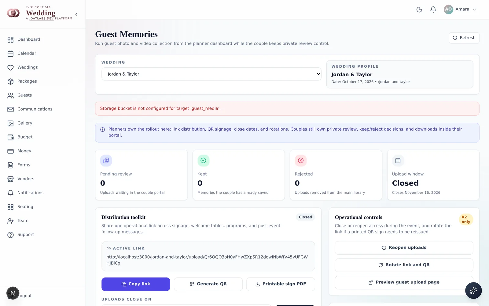

# Guest Memories

Crowd-sourced photo and video collection from guests — planners run the rollout, couples
keep private review control.

## What it is

Guest Memories lets guests upload photos and videos from the wedding via a shared link or
QR code. The planner owns the operational rollout — generating and rotating the link,
printing QR signage, and setting the upload window — while the **couple** keeps private
review control (keep/reject) inside their portal. Stats track pending review, kept,
rejected, and the upload window status. Photos are stored on Cloudflare R2 and videos in
Cloudflare Stream.

## Works with

- **[Couple Portal](couple-portal.md)** — couples review, keep/reject, and download memories there.
- **[Gallery](gallery.md)** — distinct from the curated planner gallery; this is the guest-contributed stream.
- **[Wedding Landing Pages](wedding-landing-pages.md)** — the guest upload page is reached from the wedding's links/QR.

## How to use it (planner)

1. Open **Memories** and select the **wedding**.
2. Copy the **active upload link**, **Generate QR**, or download a **Printable sign PDF** for welcome tables and programs.
3. Set the **upload window** close date, and **reopen** or **rotate** the link/QR if a printed sign needs to be reissued.
4. Use **Preview guest upload page** to see what guests will experience.

## What guests and couples do

1. **Guests** open the link or scan the QR and upload photos/videos.
2. **Couples** review uploads in their portal, **keep** or **reject** each, and download the ones they want to save.

## Roles & access

Operated by **Planners**; uploaded to by **Guests**; curated by the **Couple**. Requires
configured media storage.
