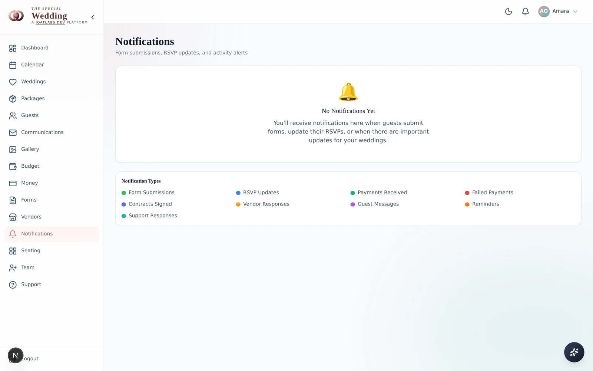

# Notifications

In-app, web-push, and email notifications that keep planners on top of RSVPs, messages,
payments, and platform events.

## What it is

The Notifications center collects the events a planner needs to know about — new RSVPs,
incoming messages, delivery failures, payment events, and system alerts. Notifications
are delivered three ways: **in-app** (the bell in the top bar and this center),
**Web Push** (browser notifications via VAPID, even when the tab is closed), and
**email** alerts. Real-time updates stream to the app over Server-Sent Events.

## Works with

- **[Communications & Reminders](communications-and-reminders.md)** — message delivery and failures.
- **[RSVP System](rsvp-system.md)** — new responses notify the planner.
- **[Payments & Finance Autopilot](payments-and-finance-autopilot.md)** — payment events.
- **[Platform Administration](platform-administration.md)** — system and health alerts for admins.

## How to use it

1. Click the **bell icon** in the top bar, or open **Notifications** from the sidebar.
2. Review unread items; click one to jump to the related guest, message, or wedding.
3. Enable **Web Push** when prompted to receive browser notifications while away from the app.
4. Mark items read, or clear them, to keep the list focused.

## Roles & access

**Planners**, **Team Members**, and **Root Admins** (each sees notifications relevant to
their scope).
