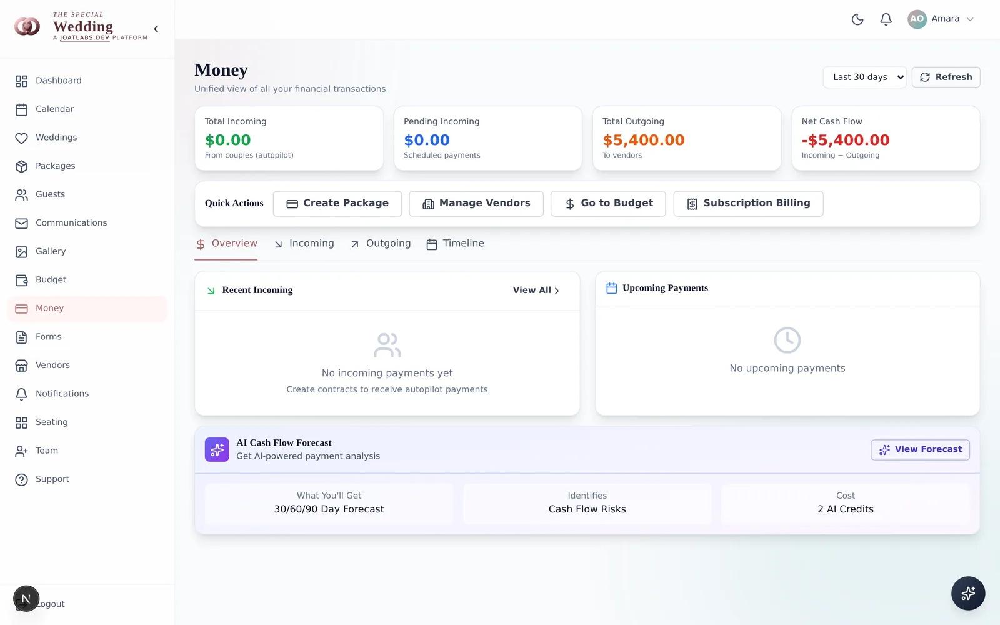

# Payments & Finance Autopilot

A unified financial view of every wedding — money coming in from couples and going out
to vendors — with AI-powered cash-flow forecasting.

## What it is

The **Money** workspace unifies all financial transactions for the planner's business.
Headline cards show **Total Incoming** (from couples), **Pending Incoming**, **Total
Outgoing** (to vendors), and **Net Cash Flow**. Tabs break the activity into Overview,
Incoming, Outgoing, and a Timeline. Quick actions jump to creating a package, managing
vendors, the budget, and subscription billing. An **AI Cash Flow Forecast** projects
30/60/90-day cash flow and flags risks.

To collect money from couples, the planner connects payouts (Stripe Connect); vendor
payments are recorded against contracts and milestones.

## Works with

- **[Service Packages](service-packages.md)** — packages sent to couples generate incoming payments ("autopilot").
- **[Vendors & Contracts](vendors-and-contracts.md)** — milestone payments to vendors are the outgoing side.
- **[Budget Tracking](budget-tracking.md)** — "Go to Budget" ties spend back to categories.
- **[Billing & Subscriptions](billing-and-subscriptions.md)** — payouts are configured alongside the planner's own subscription.
- **[AI Insights](ai-insights.md)** — the cash-flow forecast.

## How to use it

1. Open **Money**.
2. Connect payouts (Stripe) from **Billing → Payouts** so couples can pay you. Until that is set up, packages can't be sent.
3. Review the **Overview** cards and the **Incoming / Outgoing / Timeline** tabs to understand cash position.
4. Use **Quick Actions** to create a package (incoming) or manage vendor payments (outgoing).
5. Click **View Forecast** for the AI 30/60/90-day cash-flow projection and risk flags.

## Roles & access

**Planners** (business owners). Payment processing is a plan-gated feature.
