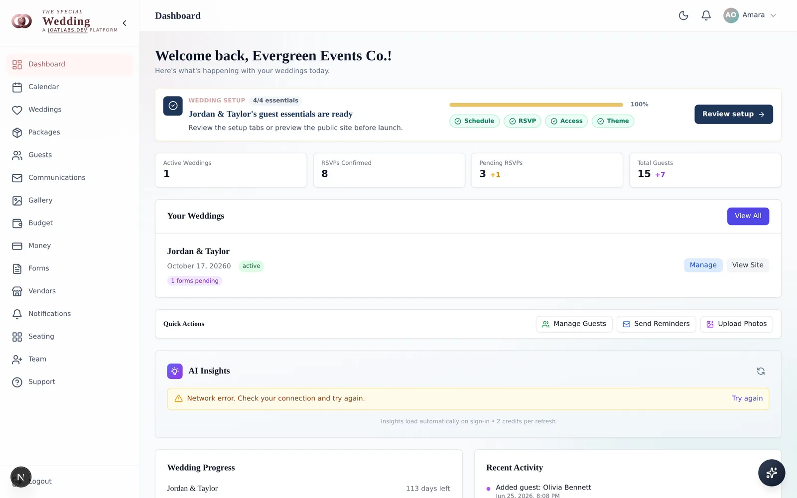

# Planner Dashboard

The planner's home base — a single screen that summarizes every active wedding and
points to the next action that needs attention.

## What it is

The dashboard is the first screen a planner sees after signing in. It surfaces
launch-readiness for each wedding (Schedule, RSVP, Access, Theme), headline counts
(active weddings, RSVPs confirmed, pending RSVPs, total guests), a list of the
planner's weddings, quick actions, AI insights, and a recent-activity feed.

## Works with

- **[Weddings](weddings.md)** — each wedding card links straight into its setup tabs and public site.
- **[Guest Management](guest-management.md)** and **[RSVP System](rsvp-system.md)** — the RSVP and guest counts roll up from here.
- **[Communications & Reminders](communications-and-reminders.md)** — the "Send Reminders" quick action.
- **[Gallery](gallery.md)** — the "Upload Photos" quick action.
- **[AI Insights](ai-insights.md)** — the dashboard insights panel.

## How to use it

1. Sign in at `/admin/login` with your planner credentials.
2. Review the **setup banner** at the top — it shows which essentials (Schedule, RSVP, Access, Theme) are complete for your next wedding and links to whatever still needs work.
3. Scan the **summary cards** for active weddings, confirmed RSVPs, pending RSVPs, and total guests.
4. Under **Your Weddings**, click **Manage** to open a wedding, or **View Site** to preview its public landing page.
5. Use **Quick Actions** to jump to Manage Guests, Send Reminders, or Upload Photos.
6. Check **Recent Activity** to see the latest changes across your weddings.

## Roles & access

Available to **Planners** and their **Team Members** (subject to permissions). Each
planner only ever sees their own weddings — the platform is multi-tenant and
tenant-isolated.
