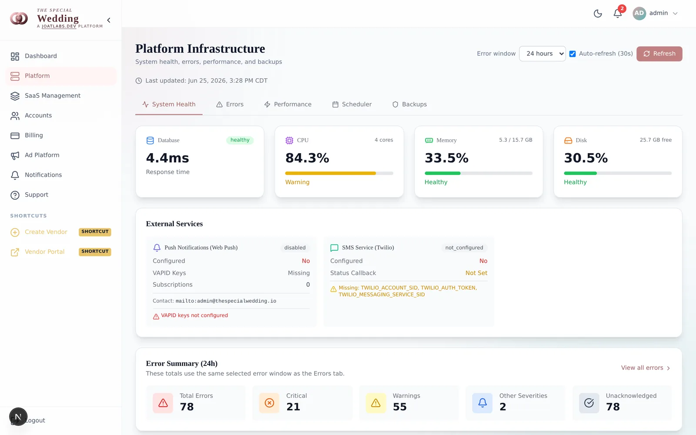
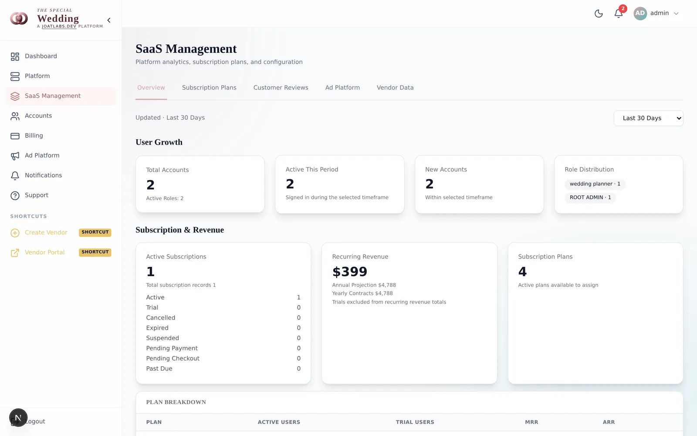

# Platform Administration

The Root Admin control plane — platform health, accounts, subscription plans, customer
reviews, and vendor advertising for the whole SaaS.

## What it is

Platform Administration is the operator-facing side of the product, available only to
**Root Admins**. It has two main areas:

**Platform Infrastructure** — system health and operations: database response time, CPU,
memory, and disk; external-service status (Web Push, Twilio, email, storage); a
scheduler and backups view; and an error summary (totals, critical, warnings,
unacknowledged) with a full error explorer. Audit logging records platform activity with
TTL-based auto-cleanup.

**SaaS Management** — the business view: user growth and role distribution, subscription
and revenue (MRR/ARR, plan breakdown), subscription-plan configuration, customer reviews,
the ad platform, and vendor data.

## Works with

- **[Billing & Subscriptions](billing-and-subscriptions.md)** — plans defined here gate every planner-facing feature.
- **[Notifications](notifications.md)** — health and error alerts.
- **[Vendors & Contracts](vendors-and-contracts.md)** — the Ad Platform and vendor directory data.

## How to use it

1. Sign in as a **Root Admin** and open **Platform**.
2. On **System Health**, monitor database/CPU/memory/disk and external-service status; set the **error window** and let it **auto-refresh**.
3. Use the **Errors**, **Performance**, **Scheduler**, and **Backups** tabs to investigate and operate.
4. Open **SaaS Management** for user growth, revenue, and **Subscription Plans** configuration.
5. Review **Customer Reviews**, the **Ad Platform**, and **Vendor Data** as needed.

## Roles & access

**Root Admin** only. Planners, team members, couples, and guests cannot reach these
views.
