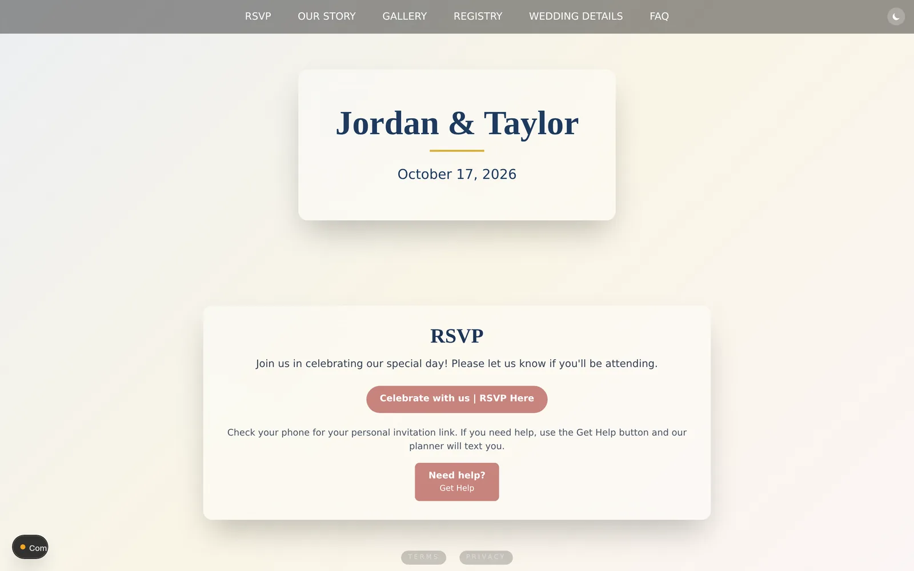

# RSVP System

A verified RSVP flow that lets guests confirm attendance from the wedding landing page,
with results tracked live on the planner's guest list.

## What it is

Guests RSVP directly from the wedding landing page. The flow is verified — a guest
confirms their identity with a one-time passcode (OTP) sent by SMS or email — so
responses are tied to the right invitee. The system detects guests who have already
responded, and a **Request RSVP Link** path lets a guest recover a lost invitation.
Responses can be per-event for multi-event weddings, and they immediately update the
guest list and dashboard counts.

## Works with

- **[Wedding Landing Pages](wedding-landing-pages.md)** — the RSVP call-to-action lives here.
- **[Guest Management](guest-management.md)** — responses update each guest's RSVP state and the summary cards.
- **[Communications & Reminders](communications-and-reminders.md)** — OTP codes and invitations are delivered via Twilio (SMS) and Resend (email).
- **[Planner Dashboard](planner-dashboard.md)** — confirmed and pending RSVP totals roll up here.
- **[Couple Portal](couple-portal.md)** — the couple watches RSVP progress in real time.

## What guests do

1. Open the wedding landing page and choose **RSVP Here**.
2. Enter the phone or email tied to their invitation and submit.
3. Enter the **one-time passcode** they receive.
4. Select which events they will attend (and decline by selecting none), add plus-ones if allowed, and submit.
5. If they lost their link, use **Need help? / Request RSVP Link** to have it re-sent.

## What planners do

1. Send invitations from **[Communications](communications-and-reminders.md) → Invites**.
2. Watch responses land on the **[Guest list](guest-management.md)** and the **dashboard** counters.
3. Filter the guest list by **RSVP state** to follow up with non-responders.

## Roles & access

Used by **Guests** (verified); monitored by **Planners**, **Team Members**, and the **Couple**.
