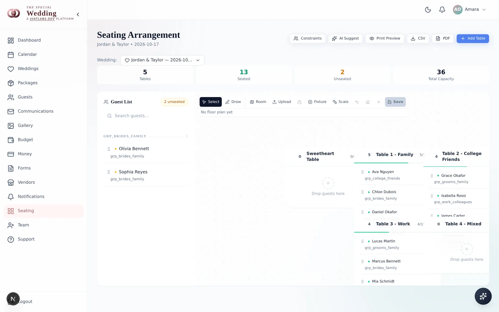

# Seating Charts

A drag-and-drop canvas for designing the reception floor plan and seating every guest,
with capacity validation and export for the venue.

## What it is

The seating tool is a visual canvas where a planner lays out tables (round, rectangle,
sweetheart), sets each table's capacity, and assigns guests by dragging them from the
guest list. Header counters track tables, seated, unseated, and total capacity. The
tool validates capacity, supports seating constraints (must-sit-with / must-sit-apart),
offers an **AI Suggest** layout, and exports a **PDF** or **banner/print preview** and
**CSV** for venue display.

## Works with

- **[Guest Management](guest-management.md)** — the guest list (and plus-ones) populates the seating sidebar; constraints come from guest records.
- **[Weddings](weddings.md)** — seating is scoped per wedding.
- **[AI Insights](ai-insights.md)** — AI Suggest proposes an optimized arrangement.

## How to use it

1. Open **Seating** and select the **wedding**.
2. Click **+ Add Table**, then set its **shape** and **capacity**; drag it into position on the canvas.
3. From the **Guest List** panel, drag guests onto a table to seat them. Watch the **seated / unseated** counters update.
4. Use **Constraints** to enforce who must sit together or apart, or **AI Suggest** to generate a starting layout.
5. Use **Draw**, **Room**, **Fixture**, and **Scale** tools to shape the venue outline and add fixtures.
6. Click **Save**, then export via **Print Preview**, **PDF**, or **CSV** for the venue.

## Roles & access

**Planners** and permitted **Team Members**. Seating orchestration is a plan-gated feature.
