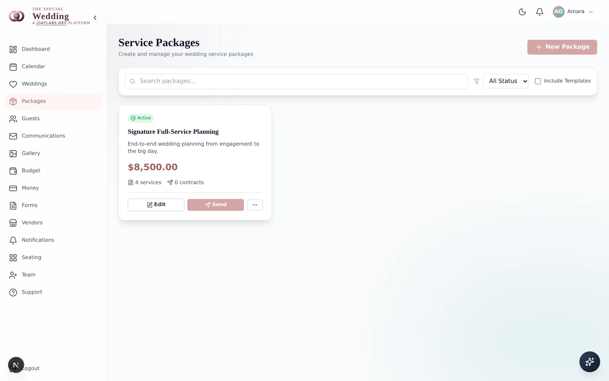

# Service Packages

Create branded service packages — what's included, the price, and the payment schedule —
and send them to couples to book and pay.

## What it is

Packages let a planner productize their offering. Each package has a name, description,
a list of included services, a total price, and a structured **payment schedule**
(for example: booking deposit, midpoint installment, final balance). Packages can be
saved as **templates**, duplicated, previewed, and **sent** to a specific couple, where
they drive incoming payments through Finance Autopilot. AI pricing can suggest a price
based on the services, location, and wedding size.

## Works with

- **[Payments & Finance Autopilot](payments-and-finance-autopilot.md)** — a sent package's payment schedule becomes scheduled incoming payments.
- **[Weddings](weddings.md)** / **[Couple Portal](couple-portal.md)** — packages are sent against a wedding and its couple.
- **[AI Insights](ai-insights.md)** — AI pricing suggestions.
- **[Billing & Subscriptions](billing-and-subscriptions.md)** — payouts must be connected before packages can be sent.

## How to use it

1. Open **Packages** and click **+ New Package**.
2. Add the **services** (each with a description and included/excluded flag) and set the **total amount**.
3. Define the **payment schedule** — name each installment and set its trigger (on signing, days before the date) and percentage/amount.
4. Optionally request an **AI pricing suggestion**, and save the package as a **template** for reuse.
5. **Preview** the package, then **Send** it to a couple. They review and pay according to the schedule.

## Roles & access

**Planners**. Couples receive and act on sent packages.
