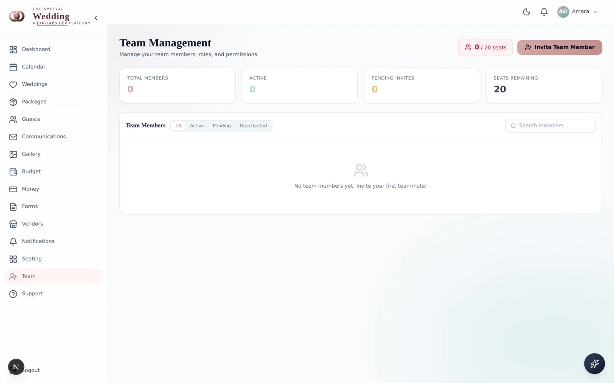

# Team Management

Invite staff to a planning business and control what each can do with role-based,
seat-limited permissions.

## What it is

Team Management lets a planner build out their business with team members. Each plan
includes a number of **seats**; the page tracks total members, active members, pending
invites, and seats remaining. Members are invited by email, accept via a tokenized link,
and are granted **role-scoped permissions** (for example: manage guests, manage budget,
manage seating, manage vendors) that gate what they can access across the planner's
weddings.

## Works with

- **Every planner feature** — permissions here decide whether a team member can use Guests, Budget, Seating, Vendors, Communications, and more.
- **[Calendar](calendar.md)** — staff appear in calendar visibility and per-staff filters.
- **[Billing & Subscriptions](billing-and-subscriptions.md)** — the plan determines how many seats are available.

## How to use it

1. Open **Team** from the sidebar.
2. Click **Invite Team Member**, enter their email, and assign their **role/permissions**.
3. The invitee receives an email and accepts via the link to join.
4. Track **active**, **pending**, and **deactivated** members from the tabs; deactivate or adjust permissions as needed.
5. Watch **seats remaining** — upgrade the plan if you need more.

## Roles & access

The **Planner** (account owner) manages the team; **Team Members** operate within their
granted permissions. Seat count is plan-gated.
