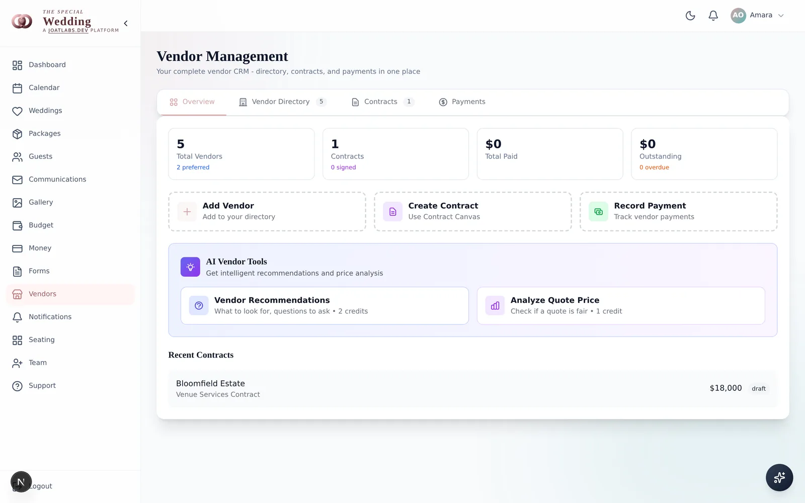

# Vendors & Contracts

A complete vendor CRM — directory, contracts, and payments — so a planner can source,
contract, and pay every vendor in one place.

## What it is

Vendor Management is organized into tabs: **Overview**, **Vendor Directory**,
**Contracts**, and **Payments**. The directory stores each vendor's business and
contact details, service category, typical price range, internal rating, and
preferred status. Contracts are created against a wedding and vendor with a total
amount, deposit, service date, and editable sections; they can be sent to the vendor
for **token-based** review and signing — no vendor account required. Payment milestones
track deposits and installments. AI tools recommend vendors and analyze whether a quote
is fair.

## Works with

- **[Weddings](weddings.md)** — contracts are scoped to a wedding.
- **[Budget Tracking](budget-tracking.md)** — vendor quotes and payments feed budget categories.
- **[Payments & Finance Autopilot](payments-and-finance-autopilot.md)** — milestone payments and payment links route through here.
- **[Form Builder](forms-builder.md)** — vendor intake forms can pre-fill contract data.
- **[AI Insights](ai-insights.md)** — vendor recommendations and quote-price analysis.

## How to use it

1. Open **Vendors**. The **Overview** shows totals (vendors, contracts, paid, outstanding) and quick actions.
2. **Add Vendor** to the directory: business name, contact, category, price range, and rating; mark **preferred** if appropriate.
3. **Create Contract**: pick the vendor, set the total amount, deposit percentage, service date, and location; edit the contract sections on the canvas.
4. **Send** the contract — the vendor opens a secure token link to review and sign.
5. Add **payment milestones** and **record payments** as they are made; track **outstanding** balances on the Payments tab.
6. Use **Vendor Recommendations** and **Analyze Quote Price** (AI) when sourcing.

## Roles & access

**Planners** and permitted **Team Members** manage vendors; **Vendors** access only the
specific contract sent to them via token link. Vendor management is a plan-gated feature.
