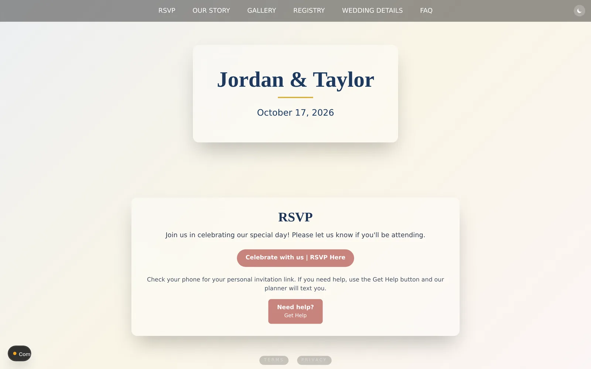

# Wedding Landing Pages

A themed, mobile-friendly, guest-facing website for each wedding — the page guests
visit to RSVP, view details, browse the gallery, and find the registry.

## What it is

Every wedding publishes a public microsite at its own slug (for example
`/{slug}`). The page leads with the couple's names and date and includes navigation to
RSVP, Our Story, Gallery, Registry, Wedding Details, and FAQ. It supports dark mode and
adapts to phones, where most guests open it.

Privacy is configurable per wedding: a page can be fully public, or gated so guests
must verify their identity (via OTP) before seeing private details or the gallery.

## Works with

- **[Weddings](weddings.md)** — the page content and slug come from the wedding's configuration.
- **[RSVP System](rsvp-system.md)** — the "RSVP Here" call-to-action launches the verified RSVP flow.
- **[Gallery](gallery.md)** — the public Gallery section displays approved photos.
- **[Guest Memories](guest-memories.md)** — guests reach the upload page from here.
- **[Couple Portal](couple-portal.md)** — couples manage Registry and FAQ content that appears on this page.

## How to use it (planner)

1. Open the wedding in **Weddings** and click **Configure**.
2. Set the **slug**, **theme**, and **privacy mode** (public or verification-required).
3. Add **Wedding Details**, **Our Story**, **Registry**, and **FAQ** content.
4. Click **View Site** (from the dashboard or wedding row) to preview the live page.
5. Share the page URL — or send personalized invitation links — to guests.

## What guests do

1. Open the wedding URL.
2. If the wedding is private, verify access when prompted.
3. Use the top navigation to RSVP, read the couple's story, view the gallery, and check the registry and FAQ.

## Roles & access

Published by **Planners**; viewed by **Guests** (public, or after verification).
