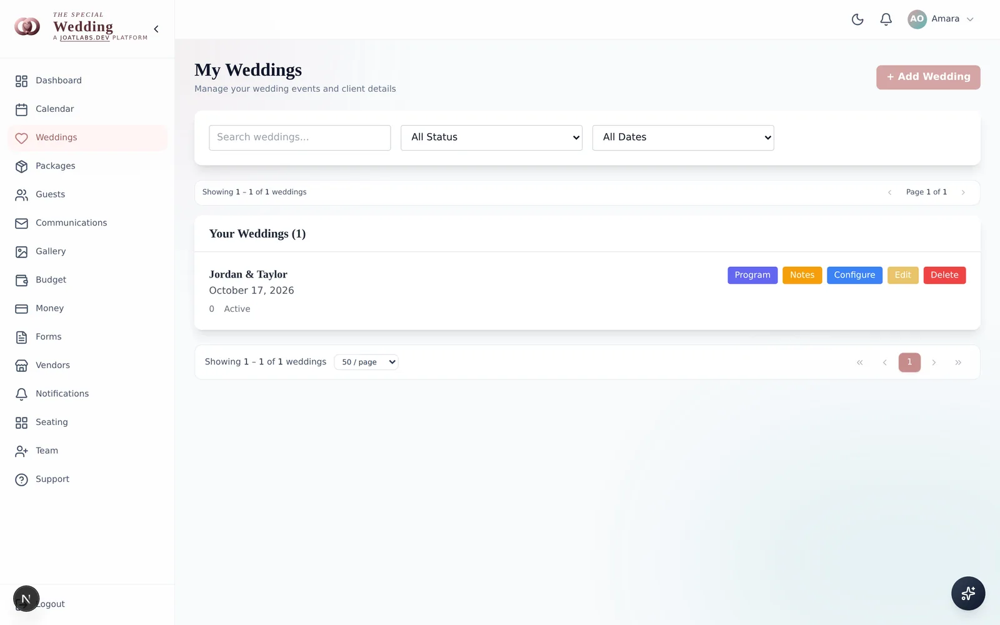

# Weddings

Create and manage each wedding event and its client details. A wedding is the central
record that every other feature attaches to.

## What it is

The Weddings area is where a planner creates a wedding, sets its couple names and date,
configures its program and privacy, and manages its lifecycle (active → completed →
archived). Every guest, RSVP, seating chart, budget, vendor contract, and gallery is
scoped to a single wedding.

## Works with

- **[Wedding Landing Pages](wedding-landing-pages.md)** — each wedding publishes a guest-facing site at its own slug.
- **[Guest Management](guest-management.md)**, **[Seating Charts](seating-charts.md)**, **[Budget Tracking](budget-tracking.md)**, **[Gallery](gallery.md)** — all are selected per wedding.
- **[Couple Portal](couple-portal.md)** — a wedding can have a couple invited to its own portal.
- **[Service Packages](service-packages.md)** — packages are sent against a wedding/couple.

## How to use it

1. Open **Weddings** from the sidebar.
2. Click **+ Add Wedding** and enter the couple names, wedding date, and venue/event details.
3. Use the row actions on each wedding:
   - **Program** — manage the order of events and schedule.
   - **Notes** — keep private planning notes.
   - **Configure** — set privacy mode, RSVP rules, theme, and the public slug.
   - **Edit** — update couple names, date, and core details.
   - **Delete** — remove the wedding (and its scoped data).
4. Filter the list by **status** or **date**, or search by couple name, to find a wedding quickly.

## Roles & access

**Planners** create and own weddings; **Team Members** act on them within their
assigned permissions. Couples and guests never see this management view.
