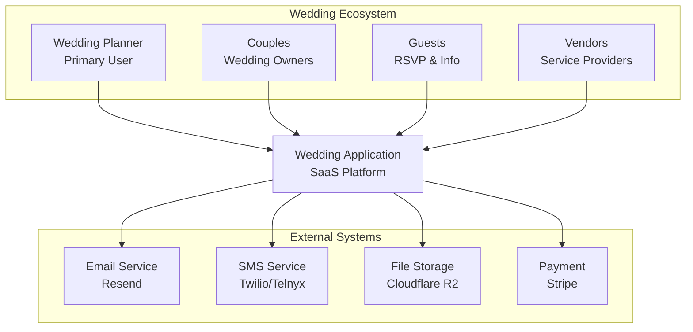
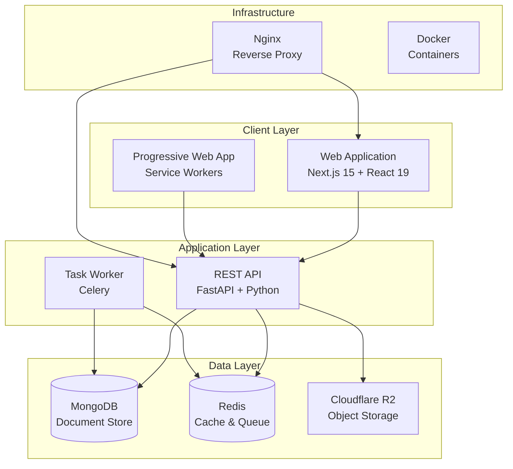
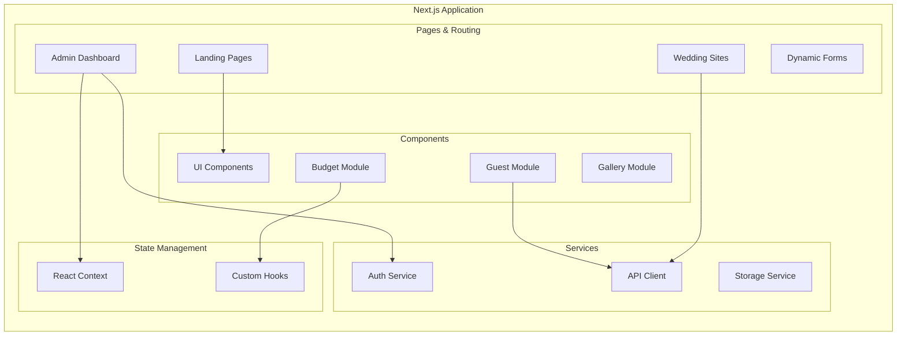
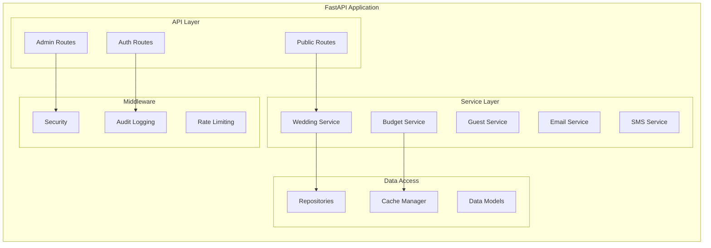
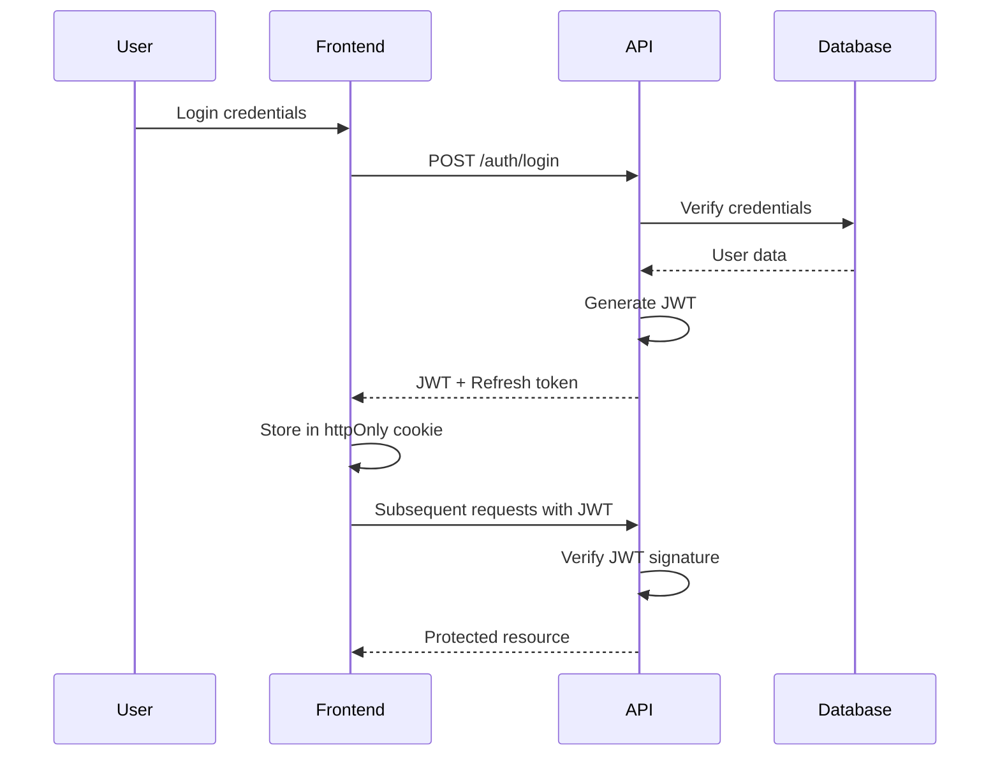
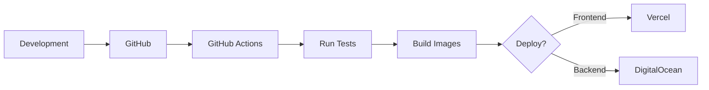

# Wedding Web Application - System Architecture

## Table of Contents
- [Executive Summary](#executive-summary)
- [System Overview](#system-overview)
- [Architecture Principles](#architecture-principles)
- [C4 Model Documentation](#c4-model-documentation)
- [Technology Stack](#technology-stack)
- [Component Architecture](#component-architecture)
- [Data Architecture](#data-architecture)
- [Security Architecture](#security-architecture)
- [Deployment Architecture](#deployment-architecture)
- [Quality Attributes](#quality-attributes)
- [Architecture Decision Records](#architecture-decision-records)

## Executive Summary

The Wedding Web Application is a comprehensive SaaS platform for wedding planning and guest management. Built with a modern microservices-ready architecture, it combines Next.js for the frontend, FastAPI for the backend, MongoDB for data persistence, and Redis for caching. The system supports multi-tenancy, real-time updates, and scales to handle hundreds of concurrent weddings.

### Key Capabilities
- **Multi-tenant SaaS Platform**: Support for multiple wedding planners managing multiple weddings
- **Dynamic Wedding Websites**: Customizable public-facing sites for each wedding
- **Comprehensive Management Tools**: Guest lists, budgets, forms, galleries, and communications
- **Real-time Features**: Live RSVP tracking, instant updates, and notification systems
- **Enterprise Security**: JWT authentication, RBAC, CSRF protection, and audit logging

## System Overview

### Architecture Style
- **Hybrid Architecture**: Combines server-side rendering (SSR) with client-side interactivity
- **API-First Design**: RESTful backend with clear separation of concerns
- **Event-Driven Communication**: Celery for asynchronous task processing
- **Microservice-Ready**: Monolithic now but structured for future decomposition

### System Boundaries
```
┌─────────────────────────────────────────────────────────────────┐
│                     Wedding Web Application                      │
├───────────────────────────────────────────────────────────────────┤
│  Frontend (Next.js)  │  Backend (FastAPI)  │  Data (MongoDB)    │
│  - SSR/SSG Pages    │  - RESTful APIs     │  - Document Store  │
│  - React Components  │  - Business Logic   │  - File Storage    │
│  - Admin Dashboard   │  - Auth & Security  │  - Cache (Redis)   │
└─────────────────────────────────────────────────────────────────┘
```

## Architecture Principles

1. **Separation of Concerns**: Clear boundaries between presentation, business logic, and data layers
2. **Security by Design**: Multi-layered security with defense in depth
3. **Scalability First**: Horizontal scaling capability through containerization
4. **Developer Experience**: Type safety, hot reloading, and comprehensive tooling
5. **Data Isolation**: Tenant data strictly separated for multi-tenancy
6. **API Consistency**: Standardized request/response patterns
7. **Progressive Enhancement**: Core functionality works without JavaScript

## C4 Model Documentation

### Level 1: System Context



### Level 2: Container Diagram



### Level 3: Component Diagram (Frontend)



### Level 3: Component Diagram (Backend)



## Technology Stack

### Frontend Technologies
| Layer | Technology | Purpose |
|-------|------------|---------|
| Framework | Next.js 15 | React framework with SSR/SSG |
| UI Library | React 19 | Component-based UI |
| Language | TypeScript 5.3 | Type-safe JavaScript |
| Styling | Tailwind CSS | Utility-first CSS |
| State | React Context | Global state management |
| Forms | React Hook Form | Form validation |
| HTTP | Fetch API | API communication |
| Build | Webpack/Turbopack | Module bundling |

### Backend Technologies
| Layer | Technology | Purpose |
|-------|------------|---------|
| Framework | FastAPI | High-performance Python API |
| Language | Python 3.11+ | Backend programming |
| ORM/ODM | Motor + Pydantic | Async MongoDB driver |
| Auth | JWT (PyJWT) | Token authentication |
| Tasks | Celery | Async task processing |
| Cache | Redis | Caching and queuing |
| Validation | Pydantic | Data validation |
| CORS | FastAPI CORS | Cross-origin support |

### Data & Infrastructure
| Component | Technology | Purpose |
|-----------|------------|---------|
| Database | MongoDB 5.0+ | Document database |
| Cache | Redis 7.0+ | In-memory cache |
| Storage | Cloudflare R2 | Object storage (S3 compatible) |
| Container | Docker | Application containerization |
| Orchestration | Docker Compose | Container orchestration |
| Proxy | Nginx | Reverse proxy & load balancer |
| Monitoring | Custom middleware | Performance & audit logging |

## Component Architecture

### Frontend Architecture

#### Directory Structure
```
app/
├── (public)/           # Public routes (no auth)
│   ├── [slug]/        # Dynamic wedding sites
│   └── landing-page/  # Marketing pages
├── admin/             # Protected admin routes
│   ├── budget/       # Budget management
│   ├── forms/        # Form builder
│   ├── gallery/      # Media management
│   ├── guests/       # Guest management
│   └── weddings/     # Wedding configuration
├── components/        # Reusable components
│   ├── ui/          # Base UI components
│   ├── budget/      # Budget-specific
│   └── forms/       # Form components
├── contexts/         # React contexts
├── hooks/           # Custom React hooks
├── services/        # API service layer
└── utils/           # Utility functions
```

#### Component Patterns
- **Atomic Design**: UI components follow atomic design principles
- **Container/Presenter**: Separation of logic and presentation
- **Compound Components**: Complex components with sub-components
- **Render Props**: Flexible component composition

### Backend Architecture

#### Service Layer Pattern
```
Request → Router → Middleware → Service → Repository → Database
           ↓          ↓            ↓          ↓
        Response ← Serializer ← Business ← Data Model
                               Logic
```

#### Directory Structure
```
app/
├── api/              # API endpoints/routers
├── core/             # Core configuration
│   ├── config.py    # App configuration
│   ├── database.py  # DB connection
│   └── settings.py  # Environment settings
├── dependencies/     # Dependency injection
├── middleware/       # Custom middleware
├── models/          # Data models
├── services/        # Business logic
├── tasks/           # Async tasks (Celery)
└── utils/           # Utility functions
```

## Data Architecture

### Database Design Philosophy
- **Document-Oriented**: Leverages MongoDB's document model
- **Denormalization**: Strategic denormalization for performance
- **Embedded Documents**: Related data stored together
- **Reference Pattern**: Cross-collection references when needed

### Core Collections

#### 1. Users Collection
```javascript
{
  _id: ObjectId,
  email: String,
  password_hash: String,
  role: Enum["ROOT_ADMIN", "admin", "planner"],
  company_name: String,
  subscription: {
    plan_id: String,
    status: String,
    expires_at: Date
  },
  assigned_weddings: [ObjectId],
  created_at: Date,
  updated_at: Date
}
```

#### 2. Weddings Collection
```javascript
{
  _id: ObjectId,
  couple_names: String,
  date: Date,
  slug: String,
  venue: Object,
  theme_config: {
    primary_color: String,
    secondary_color: String,
    font_family: String
  },
  settings: {
    rsvp_enabled: Boolean,
    gallery_enabled: Boolean,
    form_enabled: Boolean
  },
  planner_id: ObjectId,
  created_at: Date,
  updated_at: Date
}
```

#### 3. Guests Collection
```javascript
{
  _id: ObjectId,
  wedding_id: ObjectId,
  name: String,
  email: String,
  phone: String,
  group_id: String,
  rsvp_status: Enum,
  plus_ones: Array,
  dietary_restrictions: String,
  created_at: Date
}
```

#### 4. Budget Categories Collection
```javascript
{
  _id: ObjectId,
  wedding_id: ObjectId,
  name: String,
  budgeted_amount: Number,
  actual_spent: Number,
  payments: [
    {
      amount: Number,
      vendor: String,
      date: Date,
      method: String
    }
  ],
  priority: Number
}
```

### Data Flow Patterns

#### Write Path
```
Client Request → API Validation → Service Layer → Data Model
                                       ↓
                              Business Rules Check
                                       ↓
                              MongoDB Write → Cache Invalidation
                                       ↓
                              Audit Log → Response
```

#### Read Path
```
Client Request → Cache Check → Cache Hit? → Return Cached
                     ↓              ↓
                  Cache Miss   MongoDB Query
                                    ↓
                              Transform Data
                                    ↓
                              Update Cache → Response
```

## Security Architecture

### Defense in Depth Strategy

#### Layer 1: Network Security
- **HTTPS Only**: TLS 1.3 encryption in transit
- **CORS Policy**: Strict origin validation
- **Rate Limiting**: Request throttling per IP/user
- **DDoS Protection**: Cloudflare/CDN protection

#### Layer 2: Application Security
- **JWT Authentication**: Stateless token-based auth
- **RBAC Authorization**: Role-based access control
- **CSRF Protection**: Double-submit cookies
- **Input Validation**: Pydantic models & sanitization

#### Layer 3: Data Security
- **Encryption at Rest**: MongoDB encryption
- **Field-Level Encryption**: Sensitive data encryption
- **Data Isolation**: Tenant separation
- **Audit Logging**: Comprehensive activity tracking

### Authentication Flow


### Security Headers
```python
# Implemented in SecurityHeadersMiddleware
{
    "X-Content-Type-Options": "nosniff",
    "X-Frame-Options": "DENY",
    "X-XSS-Protection": "1; mode=block",
    "Strict-Transport-Security": "max-age=31536000",
    "Content-Security-Policy": "default-src 'self'",
    "Referrer-Policy": "strict-origin-when-cross-origin"
}
```

## Deployment Architecture

### Production Environment

#### Infrastructure Stack
```
Internet
    ↓
Cloudflare (CDN/WAF)
    ↓
DigitalOcean Droplet / AWS EC2
    ↓
Nginx (Reverse Proxy)
    ↓
Docker Containers
    ├── Frontend (Next.js) - Vercel
    ├── Backend API (FastAPI)
    ├── Celery Worker
    ├── MongoDB
    └── Redis
```

### Container Configuration

#### Docker Compose Services
```yaml
services:
  api:
    - FastAPI application
    - Port 8000
    - Auto-restart

  celery-worker:
    - Async task processing
    - Email/SMS sending

  mongo:
    - Primary database
    - Volume persistence

  redis:
    - Cache & message queue
    - Append-only persistence
```

### CI/CD Pipeline



### Deployment Strategy
- **Frontend**: Vercel automatic deployment on push
- **Backend**: GitHub Actions deployment to DigitalOcean
- **Database**: Managed MongoDB Atlas (production)
- **Zero-Downtime**: Blue-green deployment pattern

## Quality Attributes

### Performance
- **Response Time**: < 200ms API responses (p95)
- **Page Load**: < 3s initial load, < 1s navigation
- **Concurrent Users**: 1000+ simultaneous users
- **Database Queries**: Indexed, optimized queries

### Scalability
- **Horizontal Scaling**: Container orchestration ready
- **Database Sharding**: MongoDB sharding capability
- **Caching Strategy**: Multi-level caching
- **CDN Integration**: Static asset distribution

### Reliability
- **Uptime Target**: 99.9% availability
- **Error Handling**: Graceful degradation
- **Circuit Breakers**: External service protection
- **Health Checks**: Automated monitoring

### Maintainability
- **Code Organization**: Clear module boundaries
- **Documentation**: Inline and external docs
- **Testing**: Unit, integration, E2E tests
- **Monitoring**: Comprehensive logging

### Security
- **Authentication**: JWT with refresh tokens
- **Authorization**: Fine-grained RBAC
- **Data Protection**: Encryption in transit/rest
- **Compliance**: GDPR/privacy considerations

## Architecture Decision Records

### ADR-001: Next.js for Frontend
**Status**: Accepted
**Context**: Need a modern React framework with SSR/SSG capabilities
**Decision**: Use Next.js 15 with App Router
**Consequences**:
- ✅ SEO optimization through SSR
- ✅ Excellent developer experience
- ✅ Built-in optimization
- ⚠️ Vendor lock-in to Vercel ecosystem

### ADR-002: FastAPI for Backend
**Status**: Accepted
**Context**: Need high-performance Python API framework
**Decision**: Use FastAPI with async support
**Consequences**:
- ✅ Automatic API documentation
- ✅ Type hints and validation
- ✅ High performance
- ⚠️ Smaller ecosystem than Django

### ADR-003: MongoDB as Primary Database
**Status**: Accepted
**Context**: Need flexible schema for varied wedding data
**Decision**: Use MongoDB document database
**Consequences**:
- ✅ Schema flexibility
- ✅ Horizontal scaling
- ✅ Rich query capabilities
- ⚠️ No ACID transactions (mitigated with patterns)

### ADR-004: Multi-tenancy via Application Logic
**Status**: Accepted
**Context**: Need to support multiple wedding planners
**Decision**: Implement tenant isolation in application layer
**Consequences**:
- ✅ Simpler infrastructure
- ✅ Cost-effective
- ✅ Easier maintenance
- ⚠️ Requires careful data isolation

### ADR-005: JWT for Authentication
**Status**: Accepted
**Context**: Need stateless authentication for scalability
**Decision**: Use JWT tokens with refresh mechanism
**Consequences**:
- ✅ Stateless and scalable
- ✅ Works across services
- ✅ Standard implementation
- ⚠️ Token revocation complexity

## Monitoring and Observability

### Logging Strategy
```
Application Logs → Structured JSON → Log Aggregation → Analysis
                         ↓
                  Audit Trail Database
```

### Metrics Collection
- **Application Metrics**: Response times, error rates
- **Business Metrics**: User activity, feature usage
- **Infrastructure Metrics**: CPU, memory, disk usage
- **Security Metrics**: Failed logins, suspicious activity

### Health Monitoring
```python
# Health check endpoints
GET /health          # Basic health
GET /health/ready    # Readiness probe
GET /health/live     # Liveness probe
GET /health/detailed # Detailed status
```

## Evolution and Roadmap

### Current State (v1.0)
- Monolithic architecture with clear boundaries
- Multi-tenant SaaS platform
- Comprehensive wedding planning features
- Production-ready deployment

### Near Term (v2.0)
- GraphQL API layer
- Real-time updates via WebSockets
- Advanced analytics dashboard
- Mobile application

### Long Term (v3.0)
- Microservices decomposition
- Event sourcing for audit trail
- AI-powered recommendations
- International expansion support

## Documentation Maintenance

### Documentation Standards
1. **Architecture diagrams**: Update quarterly
2. **ADRs**: Create for significant decisions
3. **API documentation**: Auto-generated from code
4. **Component docs**: Maintain with Storybook

### Review Process
- Monthly architecture review meetings
- Quarterly documentation updates
- Annual architecture assessment
- Continuous ADR creation

## Appendices

### A. Glossary
- **ADR**: Architecture Decision Record
- **RBAC**: Role-Based Access Control
- **SSR**: Server-Side Rendering
- **SSG**: Static Site Generation
- **JWT**: JSON Web Token
- **CSRF**: Cross-Site Request Forgery

### B. References
- [C4 Model](https://c4model.com/)
- [Next.js Documentation](https://nextjs.org/docs)
- [FastAPI Documentation](https://fastapi.tiangolo.com/)
- [MongoDB Best Practices](https://www.mongodb.com/docs/manual/practices/)

### C. Related Documents
- [CLAUDE.md](./CLAUDE.md) - Development guidelines
- [DEPLOYMENT_SETUP.md](./docs/DEPLOYMENT_SETUP.md) - Deployment procedures
- [PAYMENT_TRACKING.md](./docs/PAYMENT_TRACKING.md) - Feature documentation
- [BUDGET_MODULE.md](./docs/BUDGET_MODULE.md) - Module documentation

---

**Document Version**: 1.0.0
**Last Updated**: January 2025
**Maintained By**: Engineering Team
**Review Cycle**: Quarterly